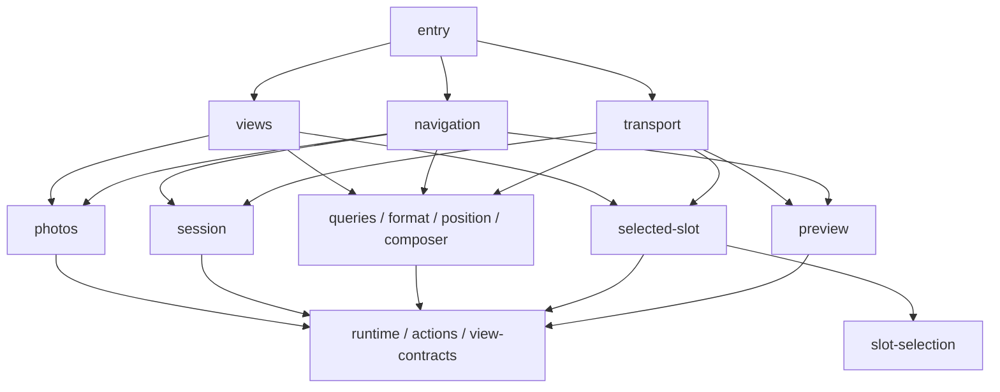

# Round 16 final offline closeout

Draft / not integrated. 2026-11-20. Worktree `/private/tmp/praxis-3c-unified`, branch `codex/feat-web-photos-unified`.

Baseline `2248c1d1e8d393163df836fd2e6092c68269e268`; its src tree matches the previous frozen source `8af0ec2a5991f7462ab352261e6371b1c476aaaa`.
Backend independent slice `d4c847ea247e9caa12958485c7b788f46ad9112c`.
Unique frozen acceptance source `1e8fbfb7051204a77b14c273f120bf41f7d8e5e2`. Evidence-only commit `9721313af2ef018abb8ca2c9364383b254818289`. Subsequent report/docs commits do not change src.

[Interaction contract](interaction-contract.md) · [Acceptance data](acceptance.json)

## Backend Stop ownership

Cancellation retries stale writes at most four times. Every attempt re-reads the snapshot and verifies the original run ID, investigation revision, nonterminal state and absence of a newer user read-start event. The real runtime supplies ordered event history. A concurrent shortlist between re-read and dispatch is retried; an obsolete Stop cannot terminate a replacement read and retains the existing 409 boundary.

Semantic preparation registers its own cancellation handle before calling the interpreter. Each handle is passed explicitly from prepareRead through runUserInitiatedRead / runAfterUserInput. Activation requires that exact handle to remain the preparation owner and not be aborted. No taskId-based pickup of a replacement handle remains. Late completion removes active ownership only when it still owns the same slot.

A pending About question in PRESENT_RESULTS cancels with PAGE_QUESTION_COMPLETED / UNVERIFIED / CANCELLED, retaining results. It does not dispatch an illegal AGENT_LOOP_TERMINATED into PRESENT_RESULTS.

| New counterexample | Observed offline result |
|---|---|
| Shortlist races after Stop re-read, twice | Both stale writes retried; final case.stopped and progress.stopped true; no EXECUTION_FAILURE |
| First semantic interpretation is held, then Stop | Stopped state; zero discovery calls and zero availability calls after release |
| Old refresh resumes while replacement is still preparing | Old request cannot start the new handle; subsequent matched Stop leaves zero extra provider calls |
| About preparation DELETE /run | HTTP 200; PRESENT_RESULTS retained; question UNVERIFIED / CANCELLED; zero question-source calls |

[Preparation 15/15](backend-green.log) · [Agent Loop 33/33](backend-loop-green.log). These are pre-freeze development checks; the same tests also pass in frozen npm test.

## Tab-isolated explicit time selection

Slot intent now uses sessionStorage, independently of tab navigation. Its key remains user / plan / requirement revision / restaurant; stored dateTime and partySize derive the current offerId from fresh inventory. Missing chosen time locks booking until explicit reselection. Empty/failed inventory, Try again, own reload, About refresh, Handoff refresh followed by Back and another tab's refreshed SSE do not erase the choice. A replacement offer for the same time rebinds automatically. Deliberate card or Saved restaurant changes clear only this tab's previous choice.

The four new Chromium journeys cover another tab's next, Back, Saved and Find more. A's 19:30 intent survives each action and reload. With current results but no 19:30, no slot is silently selected and Let's book remains disabled. If the other tab exhausts the batch, A remains empty with no stale handoff, while its restaurant-scoped intent remains stored. [New reselection screenshot](states/round16-tab-next-reselect.png).

The old Round15 shared-localStorage selection storage listener is removed. Its obsolete test branch expecting B's explicit 19:00 choice to exit A's Handoff is replaced with the new boundary: A stays on its own 19:30 Handoff. The original other-tab Back/reload control remains. [Round14–16 controls 16/16](frontend-final-controls.log) · [Four new tab journeys](frontend-tabs-green.log).

The full retained regressions cover condition edits/deletions, clarification, per-plan drafts, cross-plan questions and feedback, exhausted batches/reload, offer replacement, late Stop 409 and booking departures. They use fixed Fixture semantics; this is not a new real-source Osaka/Shibuya investigation.

## Strict browser module DAG

`tsconfig.web.json` has strict:true with independent DOM types; backend tsconfig stays unchanged. WorkspaceState and WorkspaceUi describe page-session ownership, the DOM helper maps fixed IDs and element tags to actual DOM types, and data-only browser DTOs are structurally checked against RestaurantCaseView during typecheck. No any, as-any, ts-ignore, ts-nocheck or ts-expect-error remains in browser sources. The pure slot contracts and architecture regression are executed by npm test.

All 16 browser modules form singleton strongly connected components, including type-only edges. There are zero cycles and no module imports entry. Entry alone assembles callbacks and binds events; no old String.raw workspace path or second client execution path is restored.

The diagram groups lower-level helpers; the exact complete static edges and SCCs are retained in [JSON](browser-dependencies.json) and [DOT](browser-dependencies.dot). The same graph condition is a default unit regression. Source and build serve 17 byte-identical same-origin assets, including the landing script and 16 browser modules. [Asset comparison](build-assets.json). Dependencies, lockfile, HTML/CSS, server asset serving and CSP remain byte-identical to baseline; no bundler/framework was added.

## Frozen five gates

| Gate | Result | Seconds |
|---|---|---:|
| typecheck | PASS, backend + strict browser | 0.626 |
| arch-check | PASS, 0 forbidden dependencies | 0.196 |
| test | 1789/1789 | 69.902 |
| browser-fixture | G2 5/5 · Chromium 459/459 · G6 159/159 | 419.016 |
| build | PASS | 0.590 |

All five ran on the one clean frozen source SHA above; cleanBefore/cleanAfter true, minimal environment, no dotenv. Browser child Replay tests retain their own OS network denial; the browser gate has no nested outer sandbox. G2 + Chromium aggregate is 464, not another independent test group. [Raw logs and exact manifest](gates/manifest.json).

## Offline visual acceptance

Formal 16/16 at 390×844 (7), 960×900 (2), 1440×900 (7): 41 screenshots. Style 1 6/6 at its existing 390×844, 768×1024 and 1440×900 available/unverified combinations: six screenshots. State regression 44/44: 26 screenshots. Their durations are 32.912s, 8.165s and 54.497s. All use the same frozen SHA and OS loopback-only isolation.

All 73 frames were inspected in nine contact sheets; the new desktop next-tab lock and mobile About reselection were opened individually. No new layout regression observed. Style/state fixtures intentionally show photo placeholders; formal fixtures separately verify loaded photos and Viewer behavior. [Inspection record](visual-inspection.json) · [Formal16](formal/manifest.json) · [Style log](style1-driver.log) · [States44](states-driver.log) · [Run provenance](visual-driver.json).

Formal journeys use actual HTTP/SSE + PGlite and local Chromium. They verify login, progress SSE, inline messages preserving drafts, current-candidate G1/citations, second-slot restoration, B1/SQL departure identity and blocked external navigation. Expected initial session401, deliberately damaged-image410, GPU warnings and blocked source navigation are recorded separately. App errors and unexpected HTTP failures are absent under the existing oracle. No external booking GET is allowed.

## Diagnostics and protection

The first restricted preflight failed EPERM at loopback listen before assertions. The correctly isolated baseline reproductions then failed the Stop races and About400. One ownership-test setup initially tried an illegal second refresh; it was corrected to a legal replacement message and independently reproduced 6 versus 3 source calls. [Corrected ownership red](backend-owner-red.log) · [Other baseline failures](backend-red-tap.log).

New UI tests initially read the creation response before terminal results existed; they now read the settled view. A controlled return to shared localStorage independently reproduced the next-tab/reload unlock. [Shared-storage red](frontend-shared-storage-red.log). Unfrozen development/type diagnostics remain separate from the frozen, first-attempt all-green five gates. No src changes were made after freeze.

Main and closeout HEAD/status/index/tracked data and the main .env digest match the opening snapshot. All 3358 pre-existing Unified files, including round-6 through round-15 and review directories, plus 70 restaurant-web-read files retain their SHA256. Prompt15, fingerprint, missingBlockingFields, historical Mikkeller wording and protected ADRs remain unchanged. The sole eval-source change is event-history runtime-port wiring in hybrid-read-composition; scoring/Gold are unchanged. [Protection audit](protection-check.log) · [Opening hashes](protection-baseline.json) · [Sparse check](worktree-check.json).

[Artifact SHA256 manifest](artifact-sha256.json) covers 144 files; report has its separate [SHA256](REPORT.sha256). The manifest excludes itself and these two report files to avoid recursive digests.

## Evidence limits and cleanup

Functional result: all specified offline counterexamples and retained controls pass. Stage evidence: synthetic semantic/provider inputs, actual local persistence/HTTP/SSE/Chromium and observed controls. Severity: no independent Live S0/quality evaluation was run (NOT_EVALUATED); test pass counts are not a real-world accuracy score. Attribution: request ownership, version races and shared slot storage are supported by controlled failures and passing fixes above.

No Live, real model/Google/restaurant requests, real PostgreSQL connection or port4312 use. Actual iPhone Safari / Android Chrome and real-source data quality remain untested. Fixture suites close their browsers, HTTP servers and in-memory databases; no persistent service was launched. Main, closeout and .env were not modified. No push or main merge. Stop here for the next instruction.
