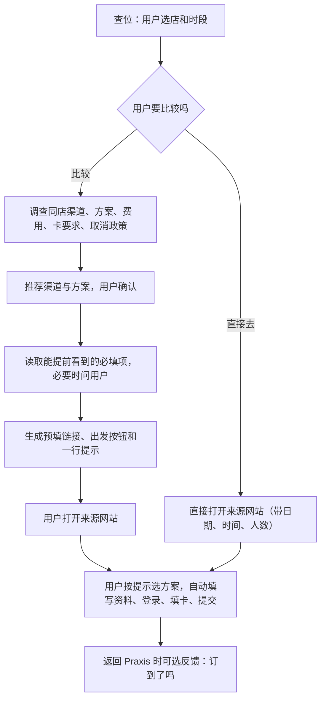

# Praxis 餐厅预约方案（草案）

- Status: Draft
- Document revision: 0.6
- Last updated: 2026-10-28
- Source of truth for: 本轮预约产品方案讨论；不覆盖 Accepted PRD、ADR 或当前实现状态
- Evidence status: draft / not integrated；原稿中的探测与验证声明是历史讨论输入，不是本轮执行证据或Clean Baseline
- Related ADRs: [ADR-0049](../decisions/0049-source-bound-b1-booking-handoff.md)
- 取代：本文件 0.5 及更早版本
- 依据：
  - `BOOKING-CHANNEL-PROBE-20261015.md`（原稿引用，含用户2026-10-16探测；本仓库未附）；
  - `BOOKING-LINK-PROBE-20261028.md`（原稿引用，2026-10-28；本仓库未附）；
  - 2026-10-27、10-28 与 Astra、Gemini 讨论后经核实保留的结论。
- Related: `MVP-ROADMAP-DRAFT.md`（原稿引用，本仓库未附）；当前入口见[MVP PRD](MVP-PRD.md)、[User Flows](USER-FLOWS.md)、[视觉方向](VISUAL-DIRECTION.md)

## 仓库归档与当前适用边界（2026-10-29）

原稿0.6来自设计输入提交`947e741b093eecd0035ebbe9401195db029920eb`，原`roadmap/BOOKING-DESIGN-DRAFT.md`按仓库约定归入本目录。以下0.6正文保留为已暴露的讨论证据，不改写其历史观察或把未附探测材料当作已验证事实。

当前B1以Accepted ADR-0049为准：只交接证实当前空位的同一渠道；Tabelog只用源响应的白名单`form_course`入口，不读取预约工作流验证链接；Select链接、跨渠道调查、B2/B2+均不在前端第一段。原稿3.2/4.3“按较严取消条款提示”已被用户2026-10-29决定取代，属于`superseded retrospective`：现在并列两种原文与各自英文转述，不由代码或模型判定严格程度。

原稿6.2的“出发按钮写明带入字段”继续适用；“最多一行提示”由用户2026-10-29复核及[ADR-0050](../decisions/0050-two-line-handoff-presentation.md)改为最多两行（一行选择项、一行核对项）。TableCheck仍核对日期和人数；取消冲突确认提醒移到推荐卡片的取消规定旁。链接、来源证据与不宣称来源实际选中/已预约的边界仍按ADR-0049；以下0.6正文作为历史输入保留，界面英文文案见[视觉方向](VISUAL-DIRECTION.md#英文文案)。

## 0.6 相对 0.5 的变化（用户 2026-10-28 同意，先做出来再看）

| 位置 | 变化 |
| --- | --- |
| 4.3 新增（原 4.3 改为 4.4） | 取消规定、要不要卡、手续费挪到推荐卡片，在用户选择时显示，作为比较依据 |
| 6.2 | "交接清单"改为"出发按钮 + 最多一行提示"；"已带入"写进按钮文字；删掉"自动填写、填卡、确认"这类无信息量的行 |
| 11 | 走查计数加一项：出发前要读几行、到来源网站后是否需要回头看 |
| 9 | **MVP = B1 + B2 + B2+（换渠道时单次查位）**；B3（多渠道查空位、套餐配对）上线后再定 |
| 4.4 | 跨渠道套餐配对不在 MVP 内；"更便宜"在 MVP 里只说渠道费用、方案差别和条件差别 |

handoff 的具体形式还要摸索，本版是第一个可做出来试的版本。

## 0.5 相对 0.4 的变化

| 位置 | 变化 |
| --- | --- |
| 1 原则 | 新增"三种说法分开"（Praxis 知道 / 链接带入 / 网站实际选中）；新增"不让用户填两遍" |
| 2 流程 | 新增"直接去来源网站"出口 |
| 4.1 | Tabelog 方案页作为"该时段可选"依据，补充 10-28 验证 |
| 6.1 预填链接 | Tabelog 可直达所选套餐的登录步骤（10-28 验证，跨浏览器可用）；TableCheck 只能带日期、时间、人数，套餐和座位不进链接（10-28 用户手机验证） |
| 6.2 卡片 | 改为按证据生成的交接清单模板；不写耗时估计；取消规定取自该店原文 |
| 6.3 新增 | 过敏和备注沿用"双语、用户确认后才复制"的规则 |
| 10 待验证 | 关闭 Tabelog `plan_id`、TableCheck 套餐与座位预选两项；新增运行环境网络要求 |
| 12 同步 | 新增两处代码改动 |

## 0. 已确定的决定

| 日期 | 决定（用户） |
| --- | --- |
| 2026-10-15 | 去掉信用卡：Praxis 不经手卡号、银行验证 |
| 2026-10-15 | 提供可能更便宜的选项（同店多渠道、多方案比较），这是 Praxis 的核心价值之一 |
| 2026-10-16 | 不单独做"信用卡探测"；卡要求随方案列表一起读取并展示 |
| 2026-10-16 | **第一版不代订。** Praxis 负责比较渠道、推荐方案、准备信息，并在用户预约时提供辅助；登录、填写个人信息、填卡和最终提交都由用户在自己的浏览器里完成 |
| 2026-10-16 | 浏览器插件保留为候选，第一版不做 |
| 2026-10-16 | Google Places `websiteUri` 计为一个渠道来源 |

不代订的原因：

- 探测中大多数预约需要信用卡；
- 代订需要的写入授权、个人信息托管、占位倒计时、持久提交记录、登录接管，成本和风险都远高于收益；
- 行业也在向这个方向走：OpenAI 已不再要求在 ChatGPT 内完成结账，改为让商家用自己的结账流程。

## 1. 产品定位与原则

用户选定一家店后，Praxis：

1. 列出这家店在同一天、同人数下可以怎么订，以及各自的费用和条件；
2. 推荐渠道和方案，用户确认；
3. 准备好预填链接，出发按钮写明带入了什么，必要时加一行提示；
4. 用户在来源网站自己完成预约。

价值主要在**读和决定**，不在**填**：

- 填表有浏览器自动填写；
- 外国用户真正难的是：
  - 该选哪个方案；
  - 同意的是什么（取消费、卡、手续费）；
  - 日文内容说的是什么。

原则：

1. **不碰卡，不托管个人信息，不提交。** Praxis 不在任何来源网站上登录、占位、填写或提交。
2. **只读，且不产生副作用。** 只读取不会占位的公开页面；不进入 TableCheck 确认页（进入即占位）。
3. **便宜要说清楚便宜在哪。** 只在已核实的选项之间比较，不宣称全网最低。费用和取消政策分开说明。
4. **有依据才承诺。** 预填内容、套餐是否可选、卡要求，只按本次观察说；没验证的明确标出。
5. **三种说法分开（0.5 新增）。** 对同一项内容（例如套餐），以下三句话是不同的承诺，界面和日志里不能混用：

   | 说法 | 含义 | 例子 |
   | --- | --- | --- |
   | Praxis 知道 | 本次在来源页面上读到 | "Omakase Nigiri ¥9,800 is listed for 10/31 19:00" |
   | 链接带入 | 链接参数里有，且验证过来源会接受 | Tabelog Select 链接带入日期、时间、人数、套餐 |
   | 网站实际选中 | 用户打开后页面确实显示为已选 | 只能由用户在来源页面确认；第一版 Praxis 看不到 |

   按钮和提示只能写"已带入"，不能写"已选好"；需要用户自己点的项目写"请选择"。
6. **不让用户填两遍（0.5 新增）。** Praxis 不收集来源网站自己会问的个人资料（姓名、电话、邮箱），这些交给浏览器自动填写。Praxis 只问会影响推荐的事（预算、偏好、饮食限制）。

## 2. 主流程

**直接去来源网站（0.5 新增）：** 查到空位后始终提供一个"Book on Tabelog / TableCheck"按钮，跳过比较和推荐。

- 适用：用户已经知道要订哪个、不在乎价格差，或比较还没查完。
- 比较是边查边展示的，不能让用户等比较结束才能走。

## 3. 调查选项（选店之后，只读）

### 3.1 选项 = 渠道 × 方案 × 时段

| 维度 | 第一版范围 |
| --- | --- |
| 渠道 | Tabelog 英文入口、TableCheck；面向外国人的代订服务（只展示对方页面写明的内容）；Tabelog 日文入口和日本国内平台只对有日本电话或账号的用户显示 |
| 方案 | 同一渠道下"只订座位"与各价位套餐 |
| 时间 | 不主动查其他时间，用户要求时再查 |

渠道发现：

1. **Google Places 的 `websiteUri`（计为一个渠道来源）**
   - 现有接入在搜索和 Place Details 中已经请求 `websiteUri`（见 `google-places-contracts.ts`），目前只用于读取官网事实。用于渠道发现**不增加 API 调用和费用**。
   - 按域名归类：

     | 域名 | 归为 |
     | --- | --- |
     | `tabelog.com` | Tabelog 渠道（从 URL 取门店编号） |
     | `tablecheck.com` | TableCheck 渠道 |
     | `omakase.in` 等面向外国人的代订服务 | 该服务渠道（只展示对方页面写明的内容） |
     | 其他 | 餐厅官网，作为一个独立渠道；官网再跳转到预约平台时，按目标平台处理 |

   - **归类只是线索，不是身份证明。** 仍按现有规则核实同一分店（电话完全一致，或店名加完整地址）后才展示为选项。
   - 探测样本中，Sushi Sen、Sushi Matsumoto 的 `websiteUri` 就是 Tabelog 页面。
2. 现有的 Tabelog、TableCheck 身份匹配。
3. Google Maps 的"Find a table"列表最全，但 Places API 不提供这份列表（只有 `reservable` 是否可预约），**不能读取**。

### 3.2 每个选项记录什么

| 字段 | 依据 |
| --- | --- |
| 同一分店 | 现有身份规则；同名不等于同店 |
| 空位 | 本渠道、同日期、同人数、同时段的本次观察；其他渠道标"未查" |
| 方案与价格 | 来源原文（含税与否、服务费）；日文方案名附英文 |
| 渠道费用 | 如 Tabelog 英文入口每人 440 日元（预约确认时从卡上扣；儿童免收；用户自己取消不退，餐厅取消则退） |
| 信用卡 | TableCheck 方案上的"Credit card required to reserve"标签；Tabelog 英文入口一律要卡；Tabelog 日文入口登录前看不到，显示"可能要卡" |
| 登录 | TableCheck 可游客预约；Tabelog 英文入口要邮箱验证；Tabelog 日文入口必须有账号 |
| 联系方式条件 | Tabelog 英文入口接受海外电话；Tabelog 日文入口要求假名姓名和电话 |
| 取消政策 | 该店该渠道的原文加英文；日英文不一致时两种都给，按较严的提示 |
| 观察时间 | 每个字段各自记录 |

### 3.3 成本

- 只在用户选定一家店之后调查，只查选定时段；
- 每次最多 3 个渠道，计入现有预算，边查边展示；
- 平台规则（例如 440 日元手续费）缓存，每日哨兵复核。

## 4. 方案推荐

### 4.1 "这个时段有位"不等于"这个套餐可选"

| 渠道 | 能证明"套餐在这个时段可选"的依据 |
| --- | --- |
| Tabelog 英文入口 | 空位接口返回的时段链接打开的是该日期、时间、人数下的方案页（`/en/booking/form_course/new?…`），不占位，不在 robots 禁止范围内。列在这一页的方案可视为该时段可选。例：Sendou 10/24 18:30 列出 3 个，Tokyo Ten 10/23 17:30 列出 4 个，Sendou 10/31 19:00 列出 3 个（10-28） |
| TableCheck | 方案上的"有效日期 / 星期 / 时段"只说明适用范围，不证明该时段还有名额。新版页面在"Find availability"之后可能按方案显示时间，**待验证**。验证前只说"该方案适用这个时段"，由用户在页面上确认 |

### 4.2 推荐规则

1. **先过滤：** 只保留适用于该日期、星期、时段、人数，且未过期的方案。探测中 TableCheck 列表里仍有 2023–2025 年的过期方案。
2. **再匹配：** 按用户的预算、偏好（omakase、含饮品、龙虾等）和饮食要求挑选。用户给过明确规则（"只订座位""符合预算的最低价"）时直接按规则选，不再追问。
3. **给出建议：**
   - **一个最合适：** "Choose *Omakase Course* (¥9,900): within your budget."
   - **两三个都合适：** 列出差别（"+¥3,300 adds drinks"），用户在 Praxis 里点选。
   - **信息不够：** 问一个问题，或推荐符合条件的最低价并说明理由。
4. 不同方案的卡要求不同时一并说明。例如 141 只有包间方案要卡。

### 4.3 条款放在选择的地方（0.6 新增）

取消规定、要不要卡、手续费是**做选择的依据**，在推荐卡片上、用户点选方案的地方显示，不留到出发前再读一遍。

- 取消规定：取自该店该渠道的原文，一句话英文；日英文不一致时按严的说，并标出原文出处。
- 卡：按 3.2 的依据写"Card required" / "No card needed" / "May require a card"。
- 手续费：例如 "¥440/person Tabelog fee, not refunded if you cancel"。
- 跨渠道比较时，价格差和条款差并排显示。例："TableCheck: ¥880 less for 2 · stricter cancellation (100% within 24h)"。

### 4.4 跨渠道"同一套餐"（B3，不在 MVP 内）

MVP 不做套餐配对。说"更便宜"时只说渠道费用（例如 "No ¥440/person booking fee on TableCheck"）、同渠道的方案差别和条件差别，不说"同一套餐在 X 更便宜"。以下规则留给 B3。

- 同一套餐在不同渠道往往名字不同，要按价格加内容匹配，不能只看名字。
- 同价位有多个方案、又缺少描述时不配对。例如 Sushi Tokyo Ten 两个渠道各有两个 13,200 日元的方案，对应关系无法确定。
- 匹配确定后，可以用描述较详细一方的内容解释另一方。
- 真实例子：Sushi Tokyo Ten 的 9,900 和 16,500 两档，2 人在 TableCheck 订少付 880 日元。但 TableCheck 的取消规定更严（前 24 小时内收 100%，Tabelog 为当天）。费用和取消规定分开说。

## 5. 必填项与题目

| 渠道 | 题目在哪 | 能否提前读到（不登录、不占位） |
| --- | --- | --- |
| TableCheck 旧版（Tokyo Ten、141） | 预约页：用餐目的、第几次来、过敏、日文必答确认题 | 能 |
| TableCheck 新版（Sushi Ito） | 用餐目的、第几次来、特殊要求在确认页（占位页） | 题目不能；餐厅说明、取消政策在说明页可读 |
| Tabelog 英文入口 | 选方案后：姓名、电话、邮箱、邮箱验证 | 字段是标准的 |
| Tabelog 日文入口 | 汉字姓名、假名姓名、电话、邮箱 | 字段是标准的 |

规则：

- **只处理必填项和会影响预约的选项。** 探测中必填的是姓名、邮箱、电话和"同意取消政策"，旧版另有个别日文确认题。"用餐目的""第几次来"是选填，默认跳过，不问用户。
- 需要用户提供的答案（例如过敏），只在读到实际题目后才问。不能因为用户第一次用 Praxis，就默认他第一次去这家店。
- 个人资料交给浏览器自动填写；Praxis 不保存（原则 6）。

## 6. 交接：预填链接与出发按钮

### 6.1 预填链接

| 渠道 | 链接带入 | 用户还要自己做 | 依据 |
| --- | --- | --- | --- |
| Tabelog 英文入口（方案页链接） | 日期、时间、人数；落在该时段的方案页 | 选套餐，然后同下 | 空位接口返回的 `form_course` 链接；10-16 探测 A |
| Tabelog 英文入口（套餐 Select 链接，**首选**） | 日期、时间、人数、**套餐**；直达邮箱登录步骤 | 邮箱验证、填资料、填卡、提交 | 方案页上每个套餐的 Select 按钮是普通链接（`/en/booking/form_mail_auth_entries/new?…plan_id=…`），不含会话凭证；10-28 无 Cookie 抓取和用户无痕窗口都能打开，店名、日期、时间、人数保留 |
| TableCheck | 日期、时间、人数 | 选套餐、数量、座位类型；新版先确认餐厅说明 | `start_date` + `start_time` + `num_people`（代码现用的 `pax` 在旧版只认人数）。10-28 用户手机验证：页面上选套餐、选座位、改时间，地址栏都不变，没有出现 `menu_items`、`service_category`。旧版在已有会话时可能显示上次条件，提示里加"Check date and guests" |

规则：

- 链接只来自来源页面上实际出现的链接，服务端两次校验，模型不生成、不拼参数。没在页面上观察到的参数（如 TableCheck `menu_items`）不用。
- 绝不交出确认页（占位页）链接：这类链接绑定在会话上，在别的设备或浏览器打开是空白页。
- 拿 Tabelog Select 链接需要读取方案页，属于 B2 的只读读取。B1 先用方案页链接。
- Tabelog Select 链接还有一点不确定：从链接直接进入（没先打开方案页）时，邮箱验证后套餐是否保留。正常路径（先开方案页）10-16 已证实保留。确认前，提示写"Check the course on the payment page"（见 6.2）。

### 6.2 出发按钮 + 最多一行提示（0.6 改写）

用户在推荐卡片上已经看过条款（4.3）。出发前只需要知道：链接带入了什么，到了页面还要自己点什么。

**按钮文字写明已带入的内容**（原则 5，只写"filled in"，不写"selected"）：

| 情况 | 按钮 | 按钮下的提示 |
| --- | --- | --- |
| Tabelog Select 链接 | "Continue on Tabelog — date, time, 2 guests and *Omakase Nigiri* filled in" | 1b 确认前："Check the course on the payment page" |
| Tabelog 方案页链接（B1） | "Continue on Tabelog — date, time, 2 guests filled in" | "Pick *Omakase Nigiri ¥9,800*" |
| TableCheck | "Continue on TableCheck — date, time, 2 guests filled in" | "Pick *Omakase Nigiri ¥9,800* and *Counter*" |
| 有日文必答题时 | 同上 | 再加一行题意。例："'90分制' = you agree to a 90-minute seating" |

规则：

- 提示里的套餐名、座位名用页面上的英文原文，便于对照点选。
- 每一行都由本次观察的证据生成；没有证据就不显示。
- 不写：耗时估计；"autofill、add card、confirm"这类用户自己知道的步骤；"已选好""已预约"。
- 条款不在这里重复。用户选的方案和推荐卡片上的不同时（例如在 Praxis 里改选），按新选择重新生成按钮。

不同设备上的展示：

- **手机：** 按钮和提示在页面内；提示一行，切换标签页前看一眼就能记住。
- **电脑 Chrome / Edge：** 可以用画中画（Document Picture-in-Picture）悬浮显示提示，作为可选增强。
- **插件：** 候选，第一版不做。插件的价值在于：
  - 就地识别题目；
  - 辅助填写已确认的普通字段；
  - 读取确认页，拿到已验证的预约结果。

  但 iOS 上的 Safari 插件要打包进上架的 App，Android 上的 Chrome 不支持插件，所以手机端的成本很高。

### 6.3 过敏和备注（0.5 新增）

- 只在来源页面有对应题目或备注栏时提供。
- 用户用英文写，Praxis 给出日文译文**和**英文回译，用户确认后才显示"复制"按钮。
- 复制按钮旁写明：译文仅供参考，餐厅能否处理以餐厅回复为准。Praxis 不承诺餐厅能满足。
- 不把用户的过敏信息保存到跨会话记录，除非用户另行同意。

## 7. 返回与统计

- 用户返回 Praxis 时，最多问一次"订到了吗"，不回答不追问。只记用户自报。
- 第一版没有"已验证预约"。PRD 中 `BOOKED_VERIFIED` 和"支持路径端到端验证预约成功率 ≥ 70%"不适用于第一版。

## 8. 不做

- 代订、占位、登录接管、个人信息托管、信用卡、写入 ADR；
- 0.3.1 中的"Book for me"、Step 5–9、B4、B5 全部移除；
- 专属转发邮箱、读取用户邮箱；
- 拼接来源网站上没出现过的链接参数。

## 9. 发布顺序

| 批次 | 内容 | 需要的批准 |
| --- | --- | --- |
| B1 | 预填链接（Tabelog 方案页链接；TableCheck 日期、时间、人数）+ 出发按钮与一行提示 + 推荐卡片上的条款 +"直接去来源网站"+ 结果反馈；只用查到空位的那个渠道 | 无需改 Guard |
| B2 | 选项调查 v1：读取 Tabelog 方案页（拿套餐与 Select 链接）；同店其他渠道的方案、价格、费用、卡要求、取消政策；不进确认页；其他渠道空位标"未查" | ADR：预约页只读读取（Tabelog `form_course` 等），明确禁止进入会占位的页面 |
| B2+ | **换渠道时单次查位：** 只在推荐用户换到另一渠道时，查一次那个渠道、那个时段的空位。不查其他时段，不做套餐配对。查不到或无位时，不推荐换渠道，并保留原渠道按钮 | 同 B2；记录每次多出的页面访问和用时 |
| 上线后再定 | B3：多渠道全面查空位、跨渠道同套餐配对 | 看 MVP 数据：用户是否在意渠道差价，换渠道的比例 |

**MVP = B1 + B2 + B2+（用户 2026-10-28 决定，先不做大）。** 理由：

- 同一套餐在不同渠道的菜单价一般相同（10-16 探测 D）。"更便宜"主要来自：
  - 渠道费用（Tabelog 英文入口每人 440 日元，TableCheck 没有；Sushi Tokyo Ten 两人少付的 880 日元就是这笔费用）；
  - 同一渠道里更便宜的方案（如只订座位）；
  - 条件差别（要不要卡、取消规定）。
- 这三项 B2 都能读到，不需要 B3 的套餐配对。
- B2 唯一的缺口是"推荐换渠道，但那边没位"，由 B2+ 的单次查位补上。
| 之后 | 插件评估（电脑优先） | 上线后根据数据决定 |

## 10. 还要验证

| # | 项目 | 方式 | 状态 |
| --- | --- | --- | --- |
| 1 | Tabelog 链接能否预选套餐 | 10-28 验证 | **已关闭：** Select 链接带 `plan_id`，跨浏览器可用 |
| 1b | 从 Select 链接直接进入，邮箱验证后套餐是否保留 | 用户走一次邮箱验证，看信用卡页（可选） | 待做 |
| 2 | TableCheck 链接能否预选套餐、座位 | 10-28 用户手机验证 | **已关闭：** 不能，只带日期、时间、人数 |
| 3 | TableCheck 新版"Find availability"之后，是否按方案显示可选时间 | Claude 在用户 Chrome 只读 | 待做（关系到 4.1） |
| 4 | 再看 3–5 家新版 TableCheck 店，确认题目是否都只在确认页出现 | 同上 | 待做 |
| 5 | TableCheck "Go Back / Change" 是否立即释放占位 | 只能在真实占位时观察，不主动测 | 搁置 |
| 6 | 运行环境网络：Praxis 宿主机能访问 `cdn1/cdn2.tablecheck.com` 等资源服务器 | 部署检查 | 新增。10-28 用户电脑开代理时 TableCheck 无样式，手机正常 |

## 11. 没有用户时怎么评估

上线前找不到用户，先用两种替代方法：

- **走查计数：** 对每个渠道，按"只给链接"和"推荐卡片 + 出发按钮与提示"两种方式各走一遍，记录：
  - 需要做的操作数；
  - 需要读懂的日文段落数；
  - 需要自己做的判断（选哪个方案、取消规定）；
  - 出发前要读几行；到来源网站后是否需要切回 Praxis 再看（0.6 新增）。

  探测中 TableCheck 新版大约要经过：说明页确认、选座位类型、找空位、选时间、选方案、填姓名、邮箱、电话、选通知方式、勾取消政策、确认，约十几步，其中说明页和取消政策是日文。
- **上线后的埋点：**
  - 点击跳转到用户返回所用的时间；
  - 自报订到的比例；
  - 选择"直接去"和"比较后去"的比例；
  - 选择非原渠道或更便宜方案的比例；
  - 错链接、错误的"更便宜"说法、把"已带入"说成"已选好"：都必须为 0。

## 12. 需要同步修改的文档和代码

- **PRD：**
  - 产品定义和"核心价值是继续完成执行链路"改为"帮用户决定并准备好，用户自己完成提交"；
  - 授权规则、`BOOKED_VERIFIED` 等结果定义和 Pilot 指标标注为第一版不适用；
  - 目标用户按"在日外国人"更新。
- **User Flows：** 空位与预约流程图改为交接流程，加"直接去来源网站"出口。
- **路线图：** B1 内容已按本版第 9 节同步（10-28）。
- **ADR-0004：** 第一版不触发，保持原状。
- **代码（0.5 新增）：**
  - `tableCheckRequestedReservationUrl` 的 LINKED_PAGE 分支：`pax` 改为 `num_people`，并加 `start_time`；
  - `tabelogCapturedSlots`：保留整条 `form_course` 链接，不只保留时间。
