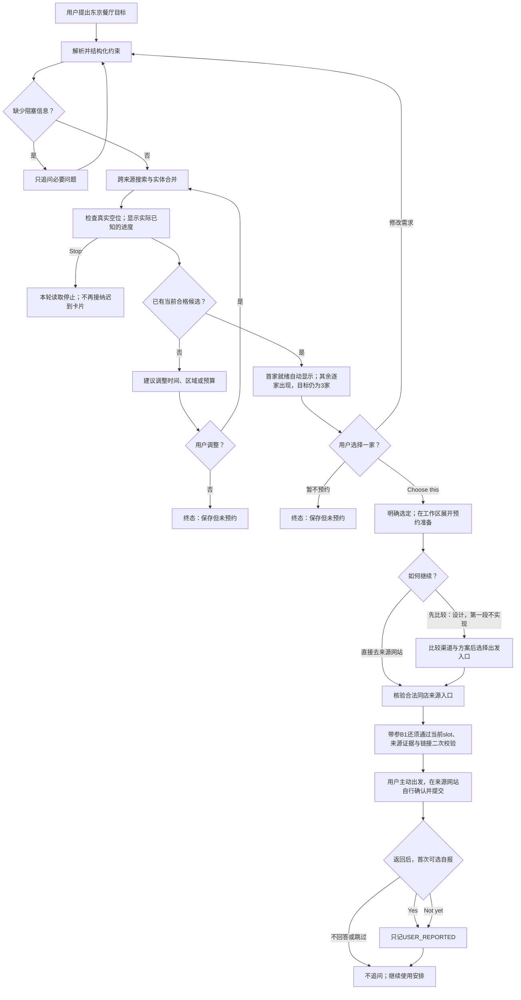
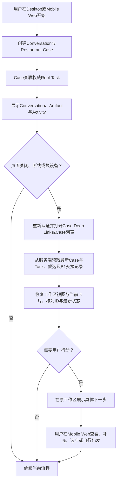

# MVP User Flows

- Status: Accepted
- Document revision: 0.40
- Last updated: 2026-11-21
- Source of truth for: 用户可见流程、确认点和终态
- Related ADRs: [ADR-0004](../decisions/0004-single-candidate-authorization.md), [ADR-0006](../decisions/0006-web-first-agent-workspace.md), [ADR-0049](../decisions/0049-source-bound-b1-booking-handoff.md), [ADR-0050](../decisions/0050-two-line-handoff-presentation.md)
- Related documents: [MVP PRD](MVP-PRD.md), [Visual Direction](VISUAL-DIRECTION.md), [Agent Gateway](../architecture/AGENT-GATEWAY-AND-WORKSPACE.md), [Restaurant Domain](../domains/RESTAURANT-BOOKING.md)

## Positive HARD basis on result cards (2026-11-03 user decision)

A current, identity-bound merchant menu, introduction or recognized source category can establish a positive non-price HARD. A source-observed outlet name/H1/alias can do so when it explicitly contains the requested cuisine/type words. Customer review titles, bodies and ratings cannot establish it. A review-only candidate is not a qualified result. The card follows qualification, shows the original quote and labels outlet-name or category evidence; a recognized category without a quote is shown as a basis without made-up quotation text. A menu dish is not presented as a specialty claim. Negative HARD, price applicability, identity, service scope and freshness rules remain. Implementation/review state is recorded in [STATUS](../STATUS.md).

## 三个位置与工作区视图

界面语言为英文。前端只有三个位置：

1. 首页：一句`What do you want to plan?`和输入框；开始一项安排后进入其工作区。
2. `My plans`：移动端左侧抽屉、桌面常驻侧栏，复用已有Conversation/Case持久化；个人资料入口在底部，`New plan`开始新安排。
3. 安排工作区：对话、查找中、单卡候选、详情、备选、比较与预约准备在此切换，不为每个动作新建页面或安排。比较是产品设计，前端第一段不实现。

顶部仅有菜单、`praxis`加群青方块光标及新安排入口。工作区底部输入框为`Adjust anything?`。查看、展开、备选和明确选定分别处理；返回候选视图时回到原来的卡片。

前端第一段在工作分支接通了本节的外壳、当前指代、逐家候选和B1呈现，本地Fixture两尺寸浏览器链路已通过；五门禁/独立视觉复核状态见[切片计划](../WEB-WORKSPACE-SLICE1-PLAN.md)。比较页等后续范围仍未实现，真实来源读者/G3缺口保留。`Choose this`在本段只将该候选定位为B1准备对象，恢复到HANDOFF视图；不走旧写入选择/Authorization路径，也不创建提交Attempt。

## 明确空位与来源交接

本图适用于按[ADR-0044](../decisions/0044-recommendation-availability-boundary.md)确定的AVAILABILITY目标：明确订位/空位措辞，或具体钟点/数字钟点时段、已知或可推断人数的坐下正餐。订位措辞即使无日期/时间仍为查位目标：可先发现候选，再按ADR-0026补问缺失时间；补充时间沿用原目标，不重新分类。既无到访日期/时间也无订位措辞的新请求为RECOMMENDATION；宽时段等灰区由语义模型判断。普通推荐见下方“附近与不要求预约的推荐”；人数孤立出现不决定目标。

直接去来源网站不等待比较完成。已有合法同店公开来源页可供用户自行查看；带参B1缺少当前空位或链接证据时不得生成或展示，不以公开页入口声称有位或已带入。Praxis不进入预约工作流页验证链接、不接管来源会话、不提交预约。方案、价格、手续费、信用卡、取消规定沿用ADR-0049的证据与措辞规则；提示按ADR-0050最多两行（一行选择项、一行核对项），取消冲突确认提醒位于推荐卡片的取消规定旁。

返回问题为`Did you get the booking?`，非阻断、每Case至多一次。新界面`Not yet`展示标签映射已有`NO`回答，关闭/跳过沿用已有Skip语义；不新增预约Outcome或反馈枚举。仍以服务端持久化claim保证并发、刷新和重启不重复询问，不能用前端记忆替代。

## 查找中、增量候选与停止

查找中显示三至四个实际阶段，逐条出现；数字只能来自流程已经确认的计数，不模拟进度百分比。第一家合格候选就绪后自动出现单卡，后续候选逐家加入；有界读取、资格、默认三家目标及不足数量的完成规则不变。

`Stop`沿用后端取消路径。停止后结束本轮进度，不再显示该轮迟到卡片；修改需求后旧请求版本的进度、候选和交接不回流。后端若无可用取消路径或进度事件，代码切片停止报告，不在前端假装。

SSE按ID局部更新；当前卡片、未发送的输入内容和展开状态保持不变，不重建整页。候选图像当前合同缺失，第一段显示店名首字及`No photo`，不使用虚构照片填补真实数据。

## 当前查看与用户指代

消息请求携带当前视图、正在看的候选ID、正在比较的候选ID集合。服务端核对用户、Conversation/Case归属和候选身份，随后才用于解析`this one`。没有有效对象时要求澄清，不猜为第一家、最近展示或已选定的店。

正在看、留作备选、正在比较均不更新明确选定状态；`Choose this`才表达选择，仍不授权外部提交。比较上下文在比较界面实际存在时才提供，第一段不虚构比较对象。

## 跨会话与Mobile Web恢复

恢复页面不得只重放聊天文本来推断当前状态。视图与当前候选的恢复属于交互定位，不写成权威选定或预约状态；候选已失效时明确展示最新状态，不自动替用户选另一家。每份安排的备选互相隔离，切换详情或备选再返回、以及刷新页面时均恢复原视图与卡片；跨设备首先恢复服务端权威Case，不把旧前台Session当作业务真相。

## 附近与不要求预约的推荐

当用户说“附近”而当前Case没有位置时，Web只读取一次设备坐标、精度和采集时间并绑定本Case；不会用服务器、VPS或代理位置代替用户，也不持续追踪。浏览器拒绝或无法取得位置时，页面提示用户在普通消息框输入站点、地址或地区，随后沿同一语义/搜索路径继续。精确坐标不显示在公开Activity或日志中。

开放推荐（例如下午与朋友见面的咖啡馆）不询问人数或强制查询空位。系统展示的每家店仍须具有门店身份、附近、咖啡馆类型和目标时段营业事实；营业不等于有桌。若在剩余预算内额外查到空位，则另行标注其门店、日期、人数和时段；UNKNOWN、访问失败或没有预约入口不阻塞已有充分依据的核心推荐，也不证明可walk-in；当前请求下明确查到无位则排除该候选。可选查位缺参数时不为此强制补问或猜测人数/时段。具体到访则沿上图补足人数并查当前slot；页面只在有明确来源证据时显示walk-in接待方式，且该提示不等于可订。

## 持续选店与另一批

候选卡将结构化每人硬预算和其他条件一并列出，分别显示满足、不满足或未核对，并引用实际价格原文及来源。硬预算超出或没有适用价格的门店不进入合格批次；SOFT 预算未满足或未知时保留披露。已有价格不表示所列课程在请求时段可订。

开放式推荐和开放式具体查位都以三家不同、已满足其各自证据门槛的结果为首批目标；用户明确数量时按该数量，指定店铺不扩展。用户可逐家查看、加入或移除备选、要求同条件的另一批，或给出不改变条件的定性反馈。查看和备选只更新当前可恢复会话，不触发模型、来源读取或预约。另一批优先返回已有池中未展示且仍有效的结果；不足时才在同一权威条件、预算与游标下继续有界调查。用户修改人数、日期、时间、区域或HARD条件时，旧请求的结果不再当作当前合格结果，备选保留为需重新核验的用户记忆。

按[ADR-0030](../decisions/0030-restaurant-category-negative-eligibility.md)，`no fast food`等餐厅类别排除禁止已知违规；有来源类别事实但判断未知的边界类型可以保留，不能宣称“已确认不是快餐”。连锁、便宜或出餐快本身不等于快餐。正向HARD仍须证据支持，过敏、污染、安全及无障碍等排除不适用此放宽。用户明确追加“不要拉面／回转寿司”通过普通需求更新收紧当前Task，不建立长期偏好。

默认三家不足时，合法读取耗尽后展示实际合格数量并说明目标差额。长时只读任务进入预留交付窗口且已有当前合格结果时，也先展示这些结果并标明未达三家，用户仍可要求续查；不能以过期或未证实的候选凑数。显式要求的数量不足仍为未完整完成，取消不会自动展示结果。

## 修改需求与现实预约的取消

修改搜索条件在原工作区更新当前需求，旧条件的结果和交接须重新核验。`Stop`只停止查找，不取消现实预约。

用户在来源网站完成的预约、付款、修改及取消，仍由用户在该网站处理。第一版不提供“创建并验证新预约，再取消旧预约”的自动流程，也不宣称可验证现实取消结果。通用授权、幂等和Outcome安全规则保留在其权威设计中，不能从用户自报推导出已验证预约或可自动取消的订单。

## 用户确认点

1. `Choose this`：明确选定一家，不创建外部写Authorization；查看和保存书签均不触发此动作。
2. 出发按钮：用户主动打开已核验的来源链接；只描述实际核验的`filled in`字段，不描述来源实际已选中或预约成功。
3. 来源网站：用户独立确认方案、条件、条款、登录、验证码、银行卡并提交，Praxis不读取或控制该会话。
4. 返回自报：`Yes / Not yet`及可跳过，不阻断继续使用，也不追问；只记`USER_REPORTED`。
5. 条件变更、旧交接失效或读取受限：说明实际限制，允许修改需求，不自动换店或重订。
6. 跨设备恢复：重新认证只恢复访问权，不批准业务动作，也不把打开页面算作选定或出发。

## 2026-10-09 即时查位窗口

用户已决定“现在/right now”查询原参考时刻起30分钟内的最早可订时段，展示具体时刻。窗口结束后停止来源读取，正常结束或询问是否查询最近可订时间；须由用户批准新窗口，不能自动顺延。身份、HARD、人数、请求与证据新鲜度保持原规则。当前单日期合同跨东京午夜无法表达完整窗口，须明确时间澄清，不缩短窗口。C6a实现与复核限制见[Accepted ADR-0039](../decisions/0039-immediate-thirty-minute-window.md)；用户于2026-10-09复核后批准Gold@7为默认，@6原文件保留不改。

## 2026-10-22 时间窗与人数的未知范围

公开页面只证实一个时刻无位时，在原时间窗内按页面实际给出的合法时刻有界续查，并保留已查点和未查范围；不能将局部无位说明成整窗无位。请求日期已确认而精确人数不可选时，如实保留该店人数未核验的 UNKNOWN 并换候选，不强选或改人数。受限工作流不反复打开，也不把受限当作无位。此规则的本轮证据为离线测试与保存产物回放，完整实时交付另验。

## Source-resolved search area

For a named nearby request, show the actual source-adopted geographic label and keep the original user location wording unchanged. The Web conversation and candidate area heading read the same source-bound continuation center that is retained in exported read artifacts. Geographic type, coordinate context and ambiguity bounds remain enforced; a different spelling alone does not fail a location. Source access or an empty lookup is not proof of a replacement location.

## 只读调查的时间收尾（ADR0045）

按ADR0045，当剩余时间不再允许读取，调查进入收尾，仅展示已有合格结果或结束并说明本轮范围/未核实缺口。正在读取到一半的门店记未知，完整完成的店按原规则保留；不让模型继续询问或改条件来延长同一调查。不改变用户地点、日期、人数、HARD或预约授权。

## G1 displayed-restaurant follow-up (offline implementation)

After results are displayed, ask through the question field on one restaurant card. The authenticated server binds the displayed outlet, original user question, allowed source reader and current read run; code selects the sole legal `ANSWER_PAGE_QUESTION` without an Agent model call, still through Validator, Router and Reducer. The normal conversation composer continues to edit the restaurant request.

The answer panel shows one short answer, verbatim source quotations in their original language, source URLs and read times. `NOT_STATED` shows “Not stated on the page” and the pages actually checked. Sensitive categories or model-reported source contradictions add “Please confirm with the restaurant”; unverified answers are discarded. This does not establish HARD satisfaction, reception policy or availability.

Current-run identity-bound pages are reused first. Each question now has an independent 60-second deadline from submission, at most three model calls and two new document visits across sessions, configured in page-question-limits.ts. A cache miss uses the same bound-outlet reader, Guard and supplied source pacing; a process restart may reread the bound outlet without a completed search budget. Twenty distinct accepted questions per conversation are counted from persistent events, including cancelled/unverified work; duplicate delivery does not count twice, and the next question asks the user to start a new search. Search results and search accounting remain unchanged. Cancellation, expiry or a newer question discards late output. State24/TaskDefinition22 are unchanged; old State23 tasks are not silently migrated or reset.

Independent review of the original 102 model answers was reported by the user: zero false claims, 84 correct answers and 23/24 correct absence judgments. The subsequent question Prompt/Schema3 repair has offline evidence only; A must independently rerun the six affected questions. It adds question-language enforcement, complete-sentence quotations, explicit review-only absence and dietary-preference guidance, and confirmation for source contradictions. No Live quality claim is made. See [ADR-0046](../decisions/0046-observed-actions-and-source-quoted-answers.md).

## G5 B1 approved follow-up

Current source-bound slot → two server URL checks → explicit Book/Continue click → persist Case departure → user-owned source tab. On return/focus or reload, atomically claim at most one feedback prompt per Case; respond Yes/No/Skip without follow-ups. Duplicate requests, unanswered prompts and restarts do not re-ask; only USER_REPORTED feedback changes, not booking state. Cancellation conflicts show Japanese and English originals with their paraphrases/citations and ask the user to confirm on the website. The first TableCheck Live must be checked by the user for actual date/time/guests, with num_people and encoded start_time=19%3A00; this is a checklist, not run evidence. See [ADR-0049](../decisions/0049-source-bound-b1-booking-handoff.md).

## B1 G3 wiring preparation branch (2026-10-30 CET)

Preparation-branch flow: current Tabelog availability → Book/Continue link carrying the checked request → explicit user departure → existing once-only self-report feedback. No booking page opens automatically. After a server restart, missing transient link evidence hides the handoff; an explicit availability refresh can obtain it again. The original preparation preceded G3 main integration; the completed rebase checkpoint is below, and C’s own merge remains pending. [Evidence plan](../../.eval-artifacts/phase3b/b1-g3-wiring/implementation/plan.md).

Historical B1 rebase checkpoint (2026-10-30 CET): the current My plans → Choose this → handoff flow has been rechecked with source-bound links. Choose this remains a view change; no booking submission occurs. C wiring awaits review and its own main merge. [Evidence](../../.eval-artifacts/phase3b/b1-g3-wiring/rebased-main/report.md).

Current baseline — B1 G3 main release (2026-10-30 CET): reviewed C wiring is ready for the authorized main publication after fresh five gates1254/186 and strict G2 all12 pages PASS. Ordinary server startup now consumes the G3 admitted raw links without extra navigation; both server checks, ADR0050 UI and UNKNOWN source selection remain. Tabelog and TableCheck are offline usable; current-source prefill and booking are not claimed. In-memory Tabelog links are unavailable after restart until another availability check. [Release evidence](../../.eval-artifacts/phase3b/b1-g3-wiring/main-release/report.md).

## B1 selected-outlet terms (2026-11-01 CET; implementation candidate)

用户选定已核实有空位且有B1链接的门店后，服务端在该次读取预算与deadline内用G1补齐取消规定、是否需要订位信用卡；英文转述及原文/页面/时间随卡片呈现。已问过且当前绑定的答案复用，不重复回答模型调用；未知/失败省略条款，Book on来源按钮不等条款完成才可用。 本分支待完整离线验收和复核，不宣称main或Live已验收；[切片证据](../../.eval-artifacts/phase3b/b1-card-terms-20261101/plan.md)。

## B1 terms conclusion reserve (2026-11-01 CET; approved main integration)

选店后的可选B1条款遵守ADR0045：读取期限为原整轮deadline减RESTAURANT_READ_CONCLUSION_RESERVE_MS，每次取页/观察到的语言导航/模型传输前重核，剩余恰20秒不得新读；在该期限取消并整组省略未完成条款，已有B1链接照常，关闭会话不受新读取门槛阻挡。普通显式G1追问独立预算、其它身份/查位/交接行为不变。助手消息在条款完成或省略后才追加；离线实际测时与最终门禁见[本次报告](../../.eval-artifacts/phase3b/b1-card-terms-reserve-20261101/report.md)，发布SHA以Git和远端核对为准。没有真实模型或Live性能结论。

## Explicit booking message records user choice (2026-11-02 CET; approved main integration)

When the user explicitly asks to book one specific restaurant and the reference is unambiguous, Praxis records that restaurant as the user's choice. An ambiguous or partial name stays unselected. Missing guests are asked first, and the requested slot is still checked before a source handoff and optional card terms appear. This does not submit or authorize a reservation. See the appended user decision in [ADR0049](../decisions/0049-source-bound-b1-booking-handoff.md); this local implementation passed independent review and is approved for main integration. Live limitations remain separate.

### Named outlet with source-owned name variants (2026-11-03; offline candidate)

A specific named Tokyo outlet can be found without asking for a separate area. Google and the booking source may use different names: exact source-owned full names require same-store identity, and a containing short name requires a unique candidate plus address-supported locality/cuisine/branch terms. Multiple branches, unknown abbreviations and conflicting identity require clarification. The source address does not become a user-supplied area. Availability, qualified presentation and both B1 server checks remain required before a booking handoff. Validation and remaining Live uncertainty are in the [C report](../../.eval-artifacts/phase3b/named-outlet-source-names-20261103/report.md).

### Booking a selected outlet after supplying missing details (2026-11-03; offline candidate)

If the user books a displayed restaurant and then supplies the party size or another missing visit field, the next result remains bound to that restaurant's source identity. The area cannot replace the selected store with nearby results. If it cannot be verified for that visit, the reply names the store and visit and asks whether other nearby restaurants are acceptable; only a subsequent accepted open request permits those alternatives. A selection still requires fresh availability before B1/terms and does not authorize booking submission.

## 2026-11-03 near-name branch investigation (offline implementation candidate)

For an explicit full outlet name with multiple possible branches, Praxis can investigate the first three in source order within the current read's budget. One full source name match after all three identity checks permits the existing availability → presentation → B1 flow; zero/multiple matches keep the clarification prompt. The remaining candidates are not alternatives offered without user agreement. Selected-outlet policy capture observes bounded page readiness before asking the two G1 questions. Missing or unverified policy text stays absent; a still-valid B1 link is unaffected, with task/run-bound omission diagnostics available outside the user's Task State.

## 来源分类对照（2026-11-11，工作分支候选）

候选卡片并列显示Google及已核对来源页的当前分类原文和来源链接；两者不同也分别呈现，不合并成一个结论，不因此改变HARD资格判断。结果回复说明找到几家及来源时段，避免把内部状态名当作用户文案。当前只经本地Fixture浏览器验证，待种子前修复复核。

## slice2 原始补充（frozen regression；2026-10-30历史，非本次验证）

以下保留slice2新增内容；旧State/TaskDefinition及“当前/待合入”表述是当时记录，不能覆盖上方main权威定义或本轮状态。新同步与验收见 `docs/WEB-WORKSPACE-SLICE2-SYNC-PLAN.md`。

前端第一段已复核并快进合main4cbc521b，接通了本节的外壳、当前指代、逐家候选和B1呈现；本地Fixture两尺寸浏览器链路、五门禁与视觉证据见[切片计划](../WEB-WORKSPACE-SLICE1-PLAN.md)。比较页等后续范围仍未实现，真实来源读者/G3缺口保留。`Choose this`在本段只将该候选定位为B1准备对象，恢复到HANDOFF视图；不走旧写入选择/Authorization路径，也不创建提交Attempt。
Current-run identity-bound pages are reused first. Each question now has an independent 60-second deadline from submission, at most three model calls and two new document visits across sessions, configured in page-question-limits.ts. A cache miss uses the same bound-outlet reader, Guard and supplied source pacing; a process restart may reread the bound outlet without a completed search budget. Twenty distinct accepted questions per conversation are counted from persistent events, including cancelled/unverified work; duplicate delivery does not count twice, and the next question asks the user to start a new search. Search results and search accounting remain unchanged. Cancellation, expiry or a newer question discards late output. At G1 integration, State24/TaskDefinition22 were unchanged; old State23 tasks are not silently migrated or reset.

## 第2段：问答、条件、变化与收尾

主输入框由视图确定路由：DETAILS发往已有单店questions接口并绑定当前展示候选；CANDIDATES/CONVERSATION发往需求消息。回答底部面板不重排当前卡片或清除草稿，外点/下滑收起。You asked按当前店显示持久事件已有的历史，最新在上，保留原引文与敏感确认；没有新增问答存储或修改G1执行规则。

条件胶囊点击只聚焦预填Change <condition> to，按原消息链调整；只有明确来源标记的推测条件才带问号。新批完成后的removed/added、移除原因和不符合新条件的备选均来自服务端投影；移除和新增均0时隐藏整行，任一非0仍显示。不把搜索页数当需求版本，不从前端缓存或自由文本猜原因。

翻过最后候选显示Any of these work?，Saved/Adjust为文字动作，Find more调用原another-batch，返回仍是最后候选。来源读取失败但有合格结果时继续展示，末尾短提示；模型理解失败保留输入，断线Reconnecting自动恢复，明确过期的交接调用原refresh。没有合格结果只写Nothing matched yet.，不能写附近没店/没有空位。

按用户2026-10-30批准，TaskDefinition22→23（State24形状不变）：NO_VERIFIED_RESULT只有服务端证明池内尚未调查的候选或既有同条件搜索续接仍有工作，且必要条件齐全时，canContinue才为true，显示Find more；否则只显示Adjust。使用原NEXT_BATCH_REPLENISHMENT_REQUESTED，保留检查/游标/备选，不重新调查已失败或不合格的店；版本、requestId幂等、预算、Stop和迟到丢弃沿用原路径。全部来源失败不使用续查，Try again复用refresh和显式刷新事件，仅重查确认失败的候选，不跑语义。工作分支验证状态见[第2段计划](../WEB-WORKSPACE-SLICE2-PLAN.md)，不是Live能力。

## 2026-11-11 CET 用户追加：条件原位修改

当前胶囊点击后在原位编辑，最长30字符；Save/Enter确认、Cancel/Escape取消，实时显示字数。确认沿已有需求messages入口，详情视图中也不走G1；不向底部输入框写入修改提示或清除原草稿。替代旧历史“底部预填”交互，结构化修改事件仍draft，未新增。

## 无变化的条件编辑与重申（2026-11-13）

地点、日期、时间窗、人数胶囊均在原位编辑。Save/Enter时若规范化后的值未改变，收起编辑器并保留底部草稿，不发送消息；人数按数值比较（2与2.0相同）。实际改变仍经原有Change消息、语义编译和Runtime更新，再读取新条件下的结果；不新增结构化修改事件。

服务端需求版本按应用patch后的完整草稿是否实际改变划分；草稿完全相同的重申保留现有展示集合及最近一次真实变更差异，不制造“所有餐厅不再匹配”。真实值、推测来源等元数据改变仍形成新版本；新条件确实无合格结果时，仍可显示原批次的移除项。备选与另一批流程继续按原合同处理。

### Round-4 workspace refinement (2026-11-18, draft / not integrated)

A Saved item remains clickable while its card is presented, including after availability expiry; booking refreshes evidence before handoff. Interrupted revised searches never claim that Saved places no longer match. Revised plan headings and My plans reflect current structured conditions. Main progress, empty/error notices and search messages appear only with candidate browsing; changing requirements hides old messages immediately. About owns full condition quotations, source links and Read at timestamps; cards show concise conclusions. Each Q&A answer uses one Source disclosure preserving every quotation and observation time, with source-page URLs deduplicated. Adjust focuses the composer with temporary guidance without moving the page or clearing a draft.

## 2026-11-18 — Refresh and result explanations

Draft / not integrated. About shows refresh only for PRESENT_RESULTS. An active/blocked refresh is disabled with Refreshing… feedback, retaining current photos and unsent text. The batch label is Refresh availability when retrying source failures, any shown outlet has offers/AVAILABLE, or the goal is AVAILABILITY; an entirely fact-only recommendation batch uses Refresh details. Active work stays in About/Handoff. Inactive failure, no verified results or removal of the current outlet returns to the main workspace and closes answer/photo overlays.

Card availability is explicitly Availability not checked (or Availability expired), independent of condition evidence. Conditions use Confirmed / Not a match / Unverified with name left and status right, and the same words in About. Generic bar/pub/izakaya and retail categories cannot establish serves beer: new assessment needs explicit merchant/menu prose or an explicitly beer-serving dining category. Stored historical presentedResults.conditionStates are not rewritten; the historical Mikkeller Case therefore still projects Confirmed.

The first actual delivery has no change summary, including after NEEDS_INPUT. Later diffs hide each zero side. An added-only N new is static, without an empty removal disclosure. Real completed empty revisions still form the next comparison baseline.

### 2026-11-19 — Round 8 workspace feedback

My plans orders cases by latest activity and names progress, ready, clarification, no results, stopped and failed states. While an eligible card is visible, the progress message and Stop searching control stay together. Partial source failures appear at the batch end.

Cards omit unverified preferences. About keeps their evidence and status, and the card still shows unverified hard conditions. If the browser blocks the booking tab, the user sees the popup message before any departure is saved.

### 2026-11-19 — Round 9 workspace feedback

A clarification shows the latest user message beside the current question, starting with the request that first needs clarification. On mobile, the stop notice fits above the fixed composer when a ready card is retained.

When the request cannot be parsed, saved restaurants remain visible and their rows cannot reopen the previous results. A stopped card can open a current booking handoff. When its availability expires, the refresh action follows the current Case permissions, and Handoff can still show a safe source link when one is available.

### 2026-11-19 — Round 10 workspace behavior

My plans updates in the background while a different plan is open. The composer keeps a separate unsent draft per plan while the page is open. Nearby requests without coordinates offer device location and accept a typed station, address or district if permission is denied.

For the same restaurant and plan revision, availability updates from the card, About, Handoff or another tab keep the chosen date, time and party size when a current offer matches. If fresh inventory has different times, the card requires a new choice. Handoff returns to the card in that case, even if a refresh completed after Back. Saved keeps a qualified restaurant from a later batch without a mismatch label.

### 2026-11-19 — Round 11 workspace closure

If a refreshed booking time disappears and new times are available, the card requires an explicit time selection before booking can continue. The workspace brings its error notice above the fixed composer. After a confirmed departure, its source tab can finish opening while the user switches plans. A claimed booking feedback prompt stays with its original plan while the page is open. It can still be answered after switching back to that plan. Reloading or reopening the page never repeats a claimed prompt. A delayed Stop affects only the read shown when it was pressed. If that read has already finished, the latest Case remains visible.

## 2026-11-20 — Tab-local time choices and changed plan conditions

User decision; work-branch implementation and offline evidence are recorded in STATUS. An explicit time choice belongs to one browser tab, authenticated user, plan, requirement revision and restaurant. sessionStorage stores the chosen date/time/party separately from page position. Another tab choosing a different slot, browsing, Back, Saved or Find more does not overwrite that choice. If B merely chooses 19:00 under the same plan revision, A remains on its own 19:30 Handoff. Shared localStorage choice synchronization is not used.

Authoritative plan conditions remain shared. A new requirementRevision (guests, date, time, area or other plan conditions) cancels pending Handoff preparation and clears this tab's old selected-slot projection. An already open Handoff immediately returns to Candidates with “Plan conditions changed. Confirm the time again.” The user must explicitly confirm the new conditions/time before opening another Handoff; the old page cannot silently become a departure for the new first offer. Saved page position carries its requirement revision: reload or plan restoration rejects an old-revision Handoff too. Same-revision refresh and offer-ID replacement preserve this tab's still-valid explicit time; a disappeared time keeps the existing reselection lock.

Concurrent uncommitted message edits are not acknowledged as accepted. The displaced request returns 409 with the current task version; the workspace synchronizes the latest plan, keeps that tab's rejected message text and shows the conflict. Explicit Stop remains cancellation, with zero subsequent source work after a stopped preparation. A current Stop may reference the newly persisted read identity before preparation has received that identity back; a genuinely obsolete Stop still cannot cancel a replacement read.

## 2026-11-21 — Persistent reconfirmation and exact Stop ownership

Time intent is tab-local and has three states: ordinary browsing with no explicit choice, SELECTED date/time/party, and RECONFIRM. Exiting an old Handoff because plan conditions changed writes RECONFIRM under one user / plan key in sessionStorage. Searching/result frames, passive navigation, missed later condition revisions and any reload keep it until explicitly resolved. SELECTED remains scoped by user / plan / revision / restaurant. No time is highlighted, Let's book is disabled and “Plan conditions changed. Confirm the time again.” stays inside the slot area. A transient error notice or page position is not the authority for this lock. Explicitly clicking a time records SELECTED and removes the lock; deliberately choosing another restaurant via paging or Saved clears it. A successful condition edit submitted from this tab's Candidates page starts ordinary browsing under the new revision. Another tab's choice in the same revision still cannot change this tab's selected time or Handoff.

Each cancellable read has a globally unique immutable handleId through semantic preparation, persistence and execution. Stop carries it beside the existing readRunId and taskVersion. A stale handle cannot cancel a replacement, even if both uncommitted preparations share version0 and the same readRunId. Without a registered cancellable owner, progress does not expose Stop. A committed semantic winner retains read ownership over an uncommitted contender. If Stop writes cancellation before that semantic dispatch, the cancelled request ends quietly with no source work; genuine competing input still conflicts instead of being silently dropped. This remains a read-only cancellation, never a cancellation of a real reservation.

## 2026-11-21 — Unresolved Case reconfirmation across missed revisions (Round 19)

RECONFIRM uses one tab-local user / plan key, independent of requirement revision and restaurant. It survives Candidates, About and Saved restoration, returning from another plan, missed remote condition edits and reload. The slot-area hint and booking lock remain until an explicit time click, a deliberate change to another restaurant, or a successful condition edit submitted from this tab's Candidates page advances the revision. Choosing the same Saved restaurant, About/Back, Find more, cancelled reads/questions, model failure, conflicts and logout/login do not resolve it. Other accounts/plans are isolated. Resolving the single key leaves no older revision lock to revive; normal browsing in a later revision can again use the first current time. No old revision-key compatibility path is used.

## 2026-11-21 — Round20 stopped About and real progress

About may ask a page question for a currently presented restaurant or an openable verified restaurant from an explicitly stopped search. Other failure/no-result/unknown-outcome states cannot ask. The same About page shows pending question text and Stop for its exact read handle. Preparation/active cancellation records a cancelled question without restarting the stopped search; answers and history survive reload. Saving after Stop remains disabled; unavailable refresh stays hidden. Search progress follows authoritative semantic/search events: Understanding before semantic commit, Request understood + Finding places before the first completed search, then Checking.

## 2026-11-21 — Round20 revised search intent and result differences

Removing/replacing criteria or changing area maintains an inherited OPEN_ENDED query deterministically: revoked terms/old area leave it, valid general intent remains, and the query stays nonempty. Explicit targets and named outlets are unchanged. General dinner discovery excludes dessert/takeaway light-food types unless the current request calls for them; named-outlet lookup retains its explicit exception. Google normal, named and detail admission use the same intent context. Change summaries compare with the last revision that actually searched/presented/ended empty, skipping clarification-only revisions but keeping a real empty search.
