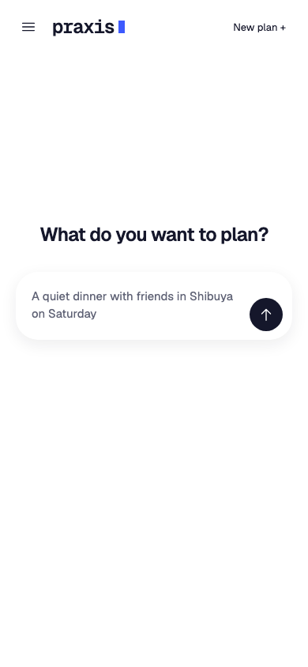
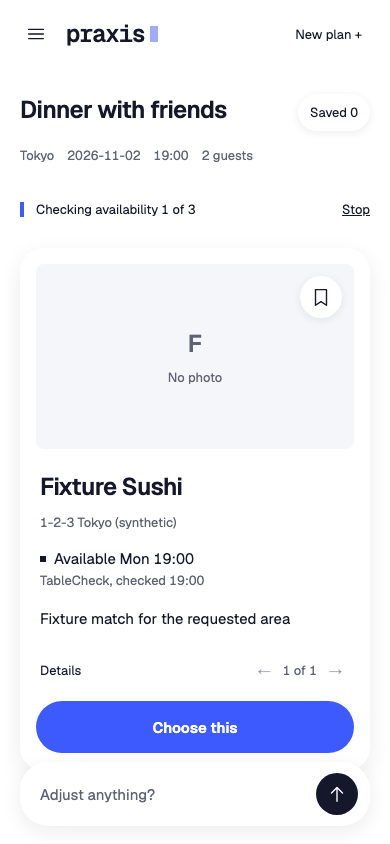
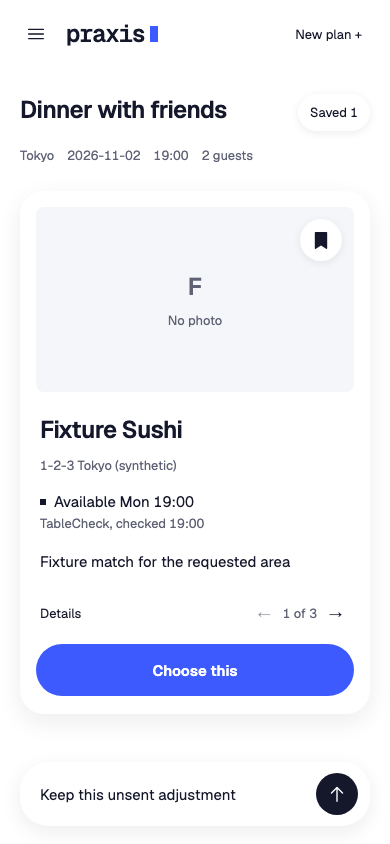
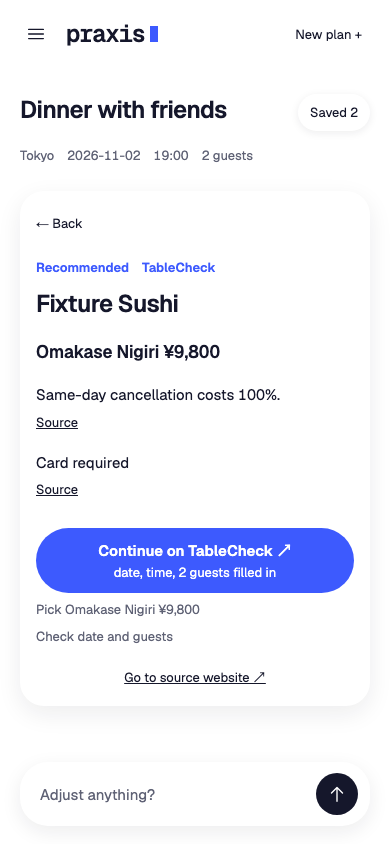
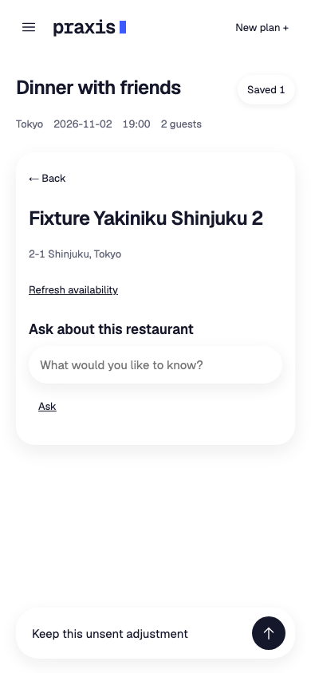
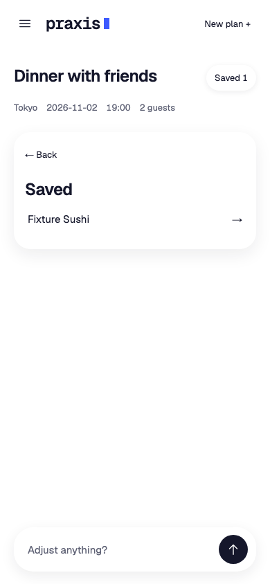
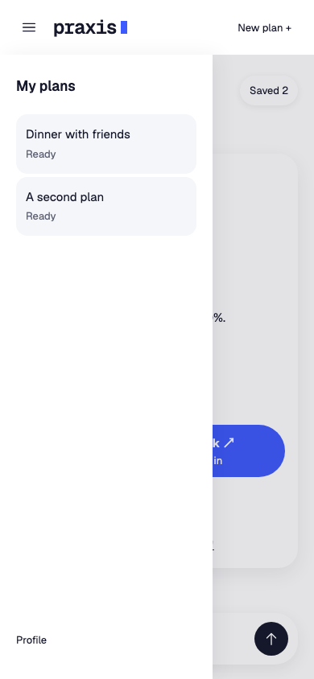
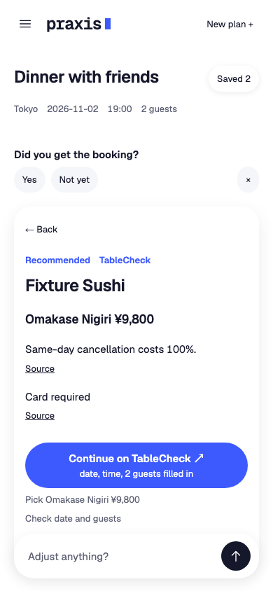
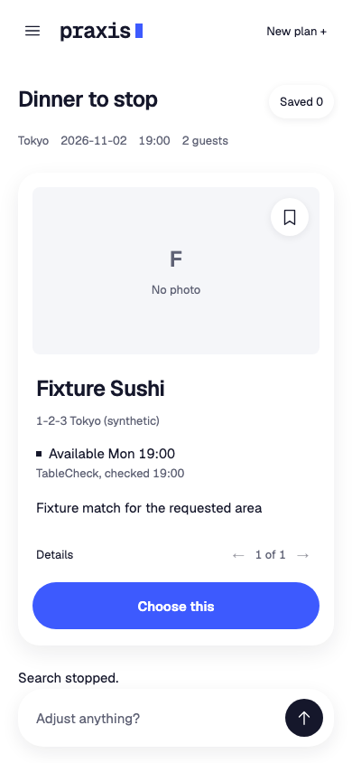
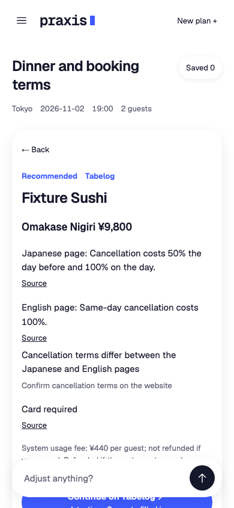

# 前端第1步：工作区与B1来源交接复核

- Status: Draft
- Document revision: 0.1
- Last updated: 2026-10-30
- Source of truth for: 本切片的实施、离线验收、截图及未覆盖边界；不替代产品、ADR或STATUS
- Related ADRs: [ADR-0049](../decisions/0049-source-bound-b1-booking-handoff.md), [ADR-0050](../decisions/0050-two-line-handoff-presentation.md)
- Related documents: [切片计划](../WEB-WORKSPACE-SLICE1-PLAN.md), [视觉规格](../product/VISUAL-DIRECTION.md), [Gateway](../architecture/AGENT-GATEWAY-AND-WORKSPACE.md)
- Evidence status: draft / not integrated；工作分支离线实现已验证，待独立视觉/代码复核，不是Clean Baseline或Live验收

## 交付结果与基线

英文首页、My plans抽屉/桌面侧栏、单卡候选、详情、备选和B1准备均在同一工作区切换。第一家资格成立即显示；进度由当前轮事件与实际生命周期投影；Stop使用已有取消路径。书签按Case持久化，视图/当前候选定位按用户与Case保存在浏览器；SSE不重建页面或输入框。照片使用No photo，Geist自托管，Mono仅logo。

第0步复核小修已推至文档分支e3c48dbddd1f33a7ee4e7afe298067df61085d2e：Human Takeover中位数第一版不适用、两行提示与就近取消冲突提醒、占位去e.g.、证据第二行checked时间。第1步从最新main00519783b3f6a3e48a53a4a0a8b03c9621c8bcf7建立codex/feat-web-workspace-slice1，再快进纳入已复核文档；开工时把范围/验收移至切片计划。

代码及测试冻结SHA为**4255fcf85b94e39a5be3760203b54ab9d831dd9c**。五门禁在此提交逐项执行，每项前后git status --porcelain均为空，HEAD不变；本报告、日志及截图是其后归档的交付证据。工作分支不合main。2026-10-30远端核对main仍为00519783，文档分支仍为e3c48dbd。

## 真实链路与替换边界

浏览器实际操作生产HTML/JS，经认证HTTP和SSE进入Application、语义Interpreter/Compiler、Validator、Router、Reducer和PGlite。新验收在模型与来源传输边界使用既有餐厅Fixture/B1 source.json及其已有双语冲突场景；TableCheck与Tabelog各走现有Grounding，缓存准备和最终B1呈现保留原两次服务端校验。没有预填合格Task State。背景生命周期配置LIVE_READ是为了复用既有异步路径，执行模式仍是**LOCAL_CHROMIUM_FIXTURE**。

合成输入固定为2026-11-02 19:00、2人，改需求变为3人；Fixture时钟固定2026-10-29T10:00Z，浏览器同步该时钟。名称、来源、读数和库存均为合成示例。出发页由Chromium本地路由接收器接住，不访问TableCheck或Tabelog。截图不证明当前来源库存。

业务真实模型、Google、来源GET、Live Read-only、Controlled Live-write及外部提交调用均**0**，未加载.env。未改A评测、B的搜索/G3、C Google客户端、Gold/Scorer/回放输入。Replay未运行；真实PostgreSQL多连接、当前网站带入与真实模型指代质量未评。

语义Prompt26→27只补当前查看上下文，复用原调用；Schema4、State24、TaskDefinition22、Agent29/Action5/Context17及B1 prepared合同2不变。B1链接检查、证据接纳、引用校验函数与父提交逐字一致，未调整来源规则。来源读者/G3普通启动缺口仍保留。

## 指定验收

[可重复脚本](../../src/harness/browser/web-workspace.test.ts)由默认Chromium门禁自动发现；两尺寸分别运行完整用户链路，不能以三项UI投影Mock替代。

| 指定行为 | 390×844 | 1280×900 | 独立可观察证据 |
| --- | --- | --- | --- |
| 1. 每份安排的备选隔离 | PASS | PASS | 两Case分别保存；返回第一份仍保留自身两条，第二份一条 |
| 2. 详情/备选返回同卡 | PASS | PASS | 固定在第二家，来回后候选ID不变 |
| 3. 首家就绪自动显示 | PASS | PASS | 第二家来源仍阻塞时，首家已显示1 of 1 |
| 4. 修改需求丢旧结果 | PASS | PASS | 2人读取被中止后仍返回；最终三份Offer均为3人 |
| 5. 刷新恢复视图/卡片 | PASS | PASS | 第二家详情刷新、B1准备刷新均恢复 |
| 6. Choose this不提交 | PASS | PASS | 无HTTP变更、无出站导航、Task未选定且无提交/授权事件 |
| 7. Stop后无新卡 | PASS | PASS | 请求中止、进度结束、迟到读取完成后仍仅首家 |
| 8. this one为当前卡 | PASS | PASS | 请求ID与服务端装配身份均为第二家；原语义链解析到该店且不写selected |
| 9. 出发/提示措辞 | PASS | PASS | filled in；按钮与两行提示均无selected/booked |
| 10. SSE保留输入/当前卡 | PASS | PASS | 同一DOM、同一候选、未发送文本不变；来源展开亦保留 |

另验证未知候选、非法视图候选引用和比较外部ID在模型前拒绝；B1返回后Not yet映射原NO，刷新不重复询问。补充Tabelog双语取消并列、确认提醒靠近取消条款、原固定¥440手续费与选择提示分离。原来源事实刷新、晚到Case列表和G1逐字引文/缺失/敏感提示三项UI回归已改接新页面，原整页布局和旧selector断言退出。

## 主要失败机制与检错

| 失败类型 | 实际反例与修复后证据 | 未覆盖边界 |
| --- | --- | --- |
| 边查边保存中断调查 | 新浏览器脚本保存首卡后释放第二家，原路径FAILED / Stale task version expected3 actual4；同脚本修复后完成三家 | 多服务进程并发未测 |
| 停止没有用户可见结束 | 原脚本已收到取消完成，Search stopped仍为空；改投影本轮取消事件后同断言通过 | 现实预约取消不属于此路径 |
| 旧请求结果串入新请求 | 刻意让被中止的2人读取继续返回；新请求最终只接受3人Offer，Stop对照保持一张 | 当前网站/模型质量未测 |
| 查看被当选定或串店 | 实际消息/模型输入固定核对第二家；Task选定字段保持空；伪造引用模型前拒绝 | 真实模型this one质量未评 |
| B1错误措辞/自动提交 | Choose this无请求；出发前无来源请求；显式出发后仅本地接收器1次，原服务端二次校验 | 实际源网站带入与预约结果未评 |

修复边查边保存时，只在同run且所有中间事件均为SHORTLIST_UPDATED的前提下，把已完成的只读/展示事件按最新任务版本重交一次。没有重跑来源，没有放宽需求修改或取消后的旧结果接纳。停止映射读取持久取消事件，没有把界面状态当权威Task状态。

开发期Fixture的时间配置、准备copy缺请求指纹、旧Mock缺字段和测试baseURL/selector错误已修正；这些环境/接线失败不计作产品检错证据。测试没有skip、反转断言、提高原门禁时限或排除保护文件。

## 五门禁

[结构化回执](assets/web-workspace-slice1-20261030/gates.json)保留冻结SHA、每项前后净树、命令及实际耗时。

| 命令 | 结果 | 秒 | 原始日志 |
| --- | --- | --- | --- |
| npm run typecheck | PASS | 0.511 | [日志](assets/web-workspace-slice1-20261030/typecheck.log) |
| npm run arch:check | PASS，0 forbidden | 0.226 | [日志](assets/web-workspace-slice1-20261030/arch-check.log) |
| npm test | 1210/1210 PASS | 27.873 | [日志](assets/web-workspace-slice1-20261030/test.log) |
| npm run build | PASS | 0.451 | [日志](assets/web-workspace-slice1-20261030/build.log) |
| npm run test:browser:fixture | 180/180 PASS | 120.133 | [日志](assets/web-workspace-slice1-20261030/browser-fixture.log) |

完整Chromium门禁先独占G2，再跑其余4-worker Fixture；原调度、时限和评分不变。本切片5项真实链路测试与改接的3项UI回归均通过；默认套件1210项未增加。旧W06/W09前置检查2/2以及所属B1/语义15项开发检查先行通过，不替代正式五门禁。没有进行质量评分；本地脚本化模型只证明接线与安全约束。

归档后新增本地引用34项检查通过，功能源码仍与冻结SHA一致。整份STATUS扫描另发现两处继承的历史缺失引用（已退役ADR-0047旧路径、p1-e-early-20261009报告）；不属于本轮新增引用，未改写历史记录。

复跑：
~~~sh
npm ci
npm run typecheck
npm run arch:check
npm test
npm run build
npm run test:browser:fixture
~~~

需已有兼容Playwright Chromium。若要重新输出截图，为浏览器门禁设置PRAXIS_WORKSPACE_VISUAL_OUTPUT为临时输出目录；测试不读取已归档截图或报告。

## 手机截图与视觉复核

以下均来自冻结代码的正式Chromium门禁，尺寸390×844；[图像清单/SHA](assets/web-workspace-slice1-20261030/screenshots.json)。已目视检查占位完整、群青胶囊、Mono范围、无中圆点分隔、当前进度/书签/提示位置；最终审美签收仍待用户。长条款自然滚动，未做桌面精修。

| 首页 | 查找中首家就绪 |
| --- | --- |
|  |  |

| 候选 | B1准备 |
| --- | --- |
|  |  |

| 详情 | 备选 |
| --- | --- |
|  |  |

| My plans | 返回自报 |
| --- | --- |
|  |  |

| 停止 | 取消冲突 |
| --- | --- |
|  |  |

桌面1280×900：[首页](assets/web-workspace-slice1-20261030/desktop-home.png)、[候选](assets/web-workspace-slice1-20261030/desktop-candidate.png)、[B1准备](assets/web-workspace-slice1-20261030/desktop-handoff.png)。

## 停止边界

本段离线验收已完成，工作分支交复核、不合main。图片链路、比较页、B2/B2+、夜间模式、问答浮层、额外动效、桌面精修均未加入。没有通过前端伪造取消/进度；没有改变B1链接或证据规则，也没有触碰A/B/C保护范围。下一步是用户视觉/代码复核；真实来源、G3接线与模型质量需各自后续授权和验收。
