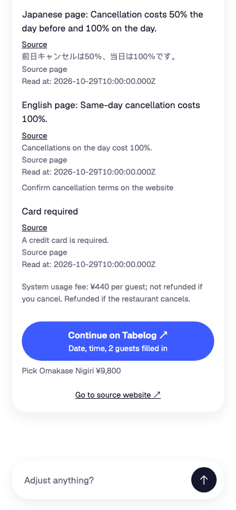
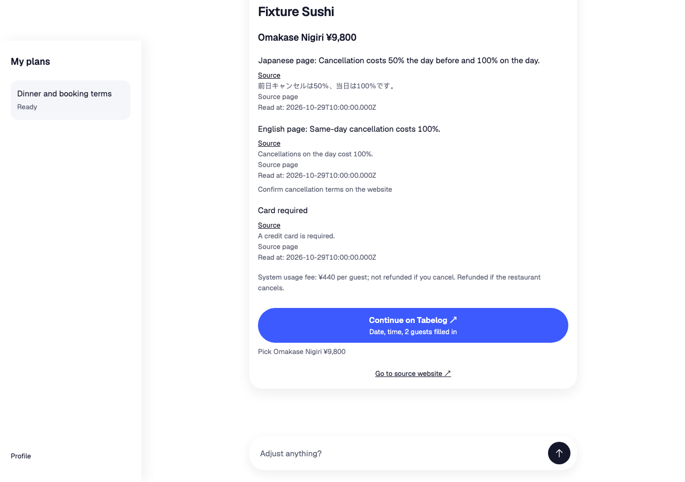
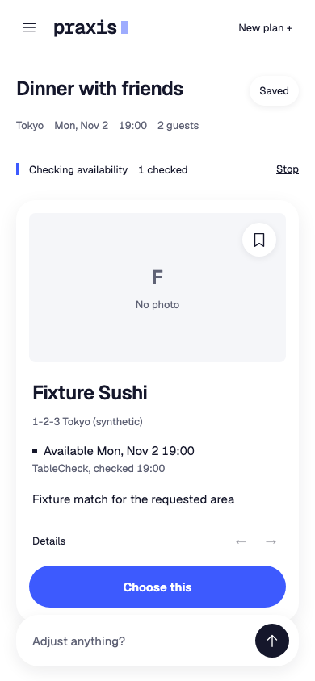
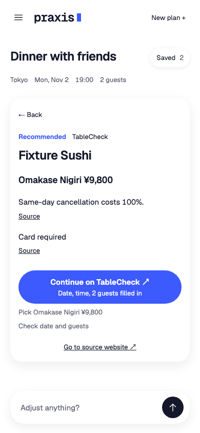

# 前端第1步复核小修（2026-10-30）

- Status: Draft
- Document revision: 0.2
- Last updated: 2026-10-30
- Source of truth for: c67c9276复核小修、受控语义单次回归及合入复核证据
- Related documents: [原交付](WEB-WORKSPACE-SLICE1-20261030.md), [切片计划](../WEB-WORKSPACE-SLICE1-PLAN.md), [Gateway](../architecture/AGENT-GATEWAY-AND-WORKSPACE.md), [视觉](../product/VISUAL-DIRECTION.md)
- Evidence status: draft / not integrated；小修离线通过，真实语义出现新增运行失败已停止；不是Clean Baseline

## 用户决定与本轮范围

c67c9276的功能、边界、十项验收已由用户2026-10-30复核通过；本轮只做指定小修并推原工作分支、不合main。

同run且只插入SHORTLIST_UPDATED时，重交一次已完成只读/展示事件的规则已签收，Gateway列出四个允许事件、完整前提和不适用情况；实现不扩大。固定输入框的实际高度、底部位置和间距通过ResizeObserver投影到内容留白与滚动安全区。两尺寸新增长双语取消条款/展开来源下的两个出发入口完整可见、点击真实本地接收器验收。

Saved零条只显示Saved；非零数字与文字用间距分开并用#5F6275。渠道名用正文色，Recommended保留群青；日期Mon, Nov 2；调查期间隐藏候选总数，进度仅显示真实已查数量；结束后再显示卡片位置/总数。冲突提醒只保留Confirm cancellation terms on the website；出发按钮第二行Date首字母大写。来源、B1链接生成/接纳、取消规定原文不变。

详情旧Ask输入框记入下一段，届时合并主输入框并按当前对象隐式指代；本轮保留原路径，不扩展单店问答。

## 提示词与已完成的离线检查

语义Prompt27→28；查看说明仅在viewingContext存在时加入。无查看上下文的提示正文和上下文投影沿用v26，固定空Draft/具名Draft×原两次Schema提示的4组字节SHA均与e3c48dbd中的v26一致。原4255fcf8/v27在相同4组上均不一致，修复后所属9项测试通过；不是仅检查一句文字消失。

两尺寸工作区及原三项UI回归开发检查9/9通过，包含新增遮挡/两个按钮实际点击；胶囊透明圆角不作为点击点，检查整个矩形在输入框上方，并对实际按钮内部做命中测试。正式五门禁与最终截图在冻结后另记。

## 真实模型运行前计划（冻结原文）

**计划15条逻辑回归，最多15次DeepSeek API请求，单次运行，API重试0。** 现有restaurant-semantic-regression@5，10个session/15个turn；模型deepseek-v4-flash。既有Schema解释器最多两次尝试不改生产配置，本轮专属传输守卫在第二次Schema请求发出前拒绝，且总API请求数封顶15，不添加任何重试。Fixture失败则不启动模型。当前真实模型调用0。

调用顺序严格为冻结代码/输入 → npm run eval:restaurant:semantic:fixture → 成功后npm run eval:restaurant:semantic:deepseek一次。模型既有入口、Gold、Scorer、用户输入和参考时间不改；外围只记录、限制调用并执行停批规则。凭据由受控Node进程从既有项目.env加载，不打印、不复制、不提交；原数据与请求/响应输出不含Authorization。

运行脚本、传输守卫、逐项对照和输入SHA清单在[本轮证据目录](../../.eval-artifacts/web-workspace-slice1-followup-20261030/freeze.json)冻结。源提交SHA在不可覆盖的execution/started.json记录，写入后才运行Fixture及真实模型；所有冻结文件在运行前后复核。传输守卫已用本地假传输验证15次上限、拒绝第二次Schema和拒绝其他来源；对照逻辑有不变v26正常控制及已知2→3人数错误检错控制，真实调用均0。

不跑Holdout，不追加具名专项/对照模型调用，不做Google、来源GET、Live或外写。遇到新增退化，保留结果、停止并报告，不调提示词追分、不补模型重跑。

## v26对照依据与预定判定

最近v26为C批次2，原代码a31ad5f127b5b032560e3066869a0e35ce09f9c8，2026-10-27。采用[已修正补评](../../.eval-artifacts/phase3b/c-batch2/semantic/posthoc-evaluation.json)及其15条DEVELOPMENT原记录；不用外层首次漏映射CONTEXT_CARRY的3个假失败。旧目标15/15、请求投影14/15（SR05双重否定）、严格0/15全部保留，不改旧分数。当前15条输入与Gold对象和参考时间与旧批逐字数据一致，SHA清单绑定；旧24条具名额外测试不纳入本轮调用。

对照逐turn列出旧/新严格状态、首个失败、模型合同、目标规则、不可评价/上游阻断。目标判定复用现有Scorer；官方严格oracle提前拒绝但保留了首轮Proposal时，仅另评该Proposal目标并明确标识，不能冒充权威Draft。旧PASS丢失、已PROPOSED变成模型/合同失败、相同初始上下文目标退化、显式数字人数从旧正确值变成与Gold冲突的新数字，均列新增退化并停下。其余不可证实的维度不填零、不推断无退化。

限定比较：旧外层遇严格失败仍继续，本轮既有官方Runner会阻断同session后续turn；State/TaskDefinition也在旧批之后更新。受影响的后续单元列BLOCKED_BY_UPSTREAM/NOT_EVALUATED，不以不同分母计算总改进率。无查看上下文的回归不证明真实this one上下文理解质量。

结果按Eval Skill四层报告：产品端到端未测；L2逐环节/字段及全部计划、开始、完成、可评分分母；L3用户影响/S0来源证据缺失明确未评价；L4首个偏离与归因证据，不能把单次噪声归因于Prompt。模型耗时/usage、实际请求、拦截重试及各项0调用边界随原件记录。

## 执行结果：按停止条件交复核

代码/评测配置冻结 **56d283b0843aa1dbb945adcb9bdaf701e0cc22da**；[开始记录](../../.eval-artifacts/web-workspace-slice1-followup-20261030/execution/started.json)在Fixture前写入。79项冻结SHA运行前后相同，功能/评测脚本在运行后没有修改。

五门禁全绿：typecheck 0.463s、arch:check 0.229s、默认 **1211/1211**（27.673s）、build 0.512s、Chromium **181/181**（120.989s），每项执行前后git status为空。[结构化门禁](../../.eval-artifacts/web-workspace-slice1-followup-20261030/gates/gates.json)及同目录五份原日志保留。

随后Fixture **15/15 PASS**，才启动唯一一次真实运行。计划15条，实际API请求 **10**，HTTP 200 **10**，API重试 **0**；Schema重试拦截也为0。总运行22.400s，网关累计22.214s。官方严格结果0/15：模型实际评价10条、9条PROPOSED、1条MODEL_FAILURE，5条同session后续BLOCKED_BY_UPSTREAM；首失败8 SEMANTIC_INTERPRETER、1 REDUCER、1 MODEL_GATEWAY。官方命令非零退出的既有严格失败保留，不改分数。

**新增运行失败为SR04-T01：v26已有PROPOSED且目标规则通过，本轮生产网关返回MODEL_FAILURE / NETWORK。按预定规则停止，不改Prompt、不补跑，不申请合main。** 这尚不是已确认的模型语义退化：传输守卫记录本条HTTP200并保存了完整有效JSON，10份原始响应均可解析。生产网关原分支读体/解析/记录路径与外围clone记录器影响尚不能区分；不能把“NETWORK”原因码单独当成网络故障证据或把HTTP200当成应用成功。根因保持UNRESOLVED，当前不继续诊断修复或追加调用。

网关记录usage仅覆盖9次成功接纳：63,412 input / 3,181 output / 66,593 total tokens；独立核对10份原始API响应的usage为 **70,461 input / 3,582 output / 74,043 total**。模型配置deepseek-v4-flash，服务端成功响应名deepseek-flash；费用未配置，不填估算。Google、来源GET、Live、Holdout、外部写入均0。所有API仅为这批公开开发语义回归。

原始证据：[官方result](../../.eval-artifacts/web-workspace-slice1-followup-20261030/execution/result.json)、[stdout/指标](../../.eval-artifacts/web-workspace-slice1-followup-20261030/execution/deepseek.log)、[传输记录](../../.eval-artifacts/web-workspace-slice1-followup-20261030/execution/transport.jsonl)、[SR04原始请求](../../.eval-artifacts/web-workspace-slice1-followup-20261030/execution/call-04.request.json)、[SR04原始响应](../../.eval-artifacts/web-workspace-slice1-followup-20261030/execution/call-04.response.json)、[独立接收/usage核对](../../.eval-artifacts/web-workspace-slice1-followup-20261030/execution/independent-receipt-check.json)、[逐项对照原件](../../.eval-artifacts/web-workspace-slice1-followup-20261030/execution/comparison.json)。原报告、冻结配置和v26原件均不覆盖。

### 四层结论

| 层 | 本轮结论与证据 | 限制 |
| --- | --- | --- |
| L1 用户目标端到端 | NOT_EVALUATED；本轮只有语义诊断。该诊断COMPLETED_WITH_FAILURE并按新增失败规则停止；不是QUALIFIED_DELIVERY或产品验收通过 | 未查店/查位/展示现实结果，首合格证据/展示时刻不适用 |
| L2 逐环节 | 15计划、10发起、10收到HTTP200、生产语义9 PROPOSED/1失败、5上游阻断；严格0/15；可评的9个目标为8个首轮Proposal与1个权威Draft，均SATISFIED | SR04目标未评；5后续未评；其他8个Proposal被严格oracle提前拒绝，不能假造其下游Draft/字段已通过；不能与旧请求投影14/15直接算新比例 |
| L3 严重程度 | 新增执行失败阻断SR04；没有可用于现实claim的独立来源，本轮产品S0–S4 NOT_EVALUATED；重试0由守卫日志及网关指标交叉核对 | 不写“S0=0”，不把内部错误直接归为用户错误声明；前端Fixture通过不能替代模型/来源质量 |
| L4 归因 | 首偏离在SR04 MODEL_GATEWAY。原始有效HTTP200响应与NETWORK返回并存；网关读体/处理或外围记录器影响均为HYPOTHESIS | 无上下文正文同v26，单次输出及不同历史执行路径不足以归因Prompt28；未做反事实重放或修复，遵守新失败即停 |

模型调用时间22.214s为既有observer累计；总22.400s中其余约0.186s未细分。浏览器/页面加载、Google、来源操作在这批模型运行中不适用；前端两尺寸验证是单列LOCAL_CHROMIUM_FIXTURE。没有用不同分母宣称改进或泛化成功。

### 与v26逐项对照

目标列使用v26已修正补评；新目标FIRST_TURN_PROPOSAL只说明保存提议的目标规则，不冒充Reducer接纳。AUTHORITATIVE_DRAFT仅SR03-T01；其他未到达维度保持未评。

| Turn | v26 严格 / 目标 | v28 严格 / 目标 | 新目标证据 | 说明 |
| --- | --- | --- | --- | --- |
| SR01-T01 | FAIL / SATISFIED | FAIL / SATISFIED | FIRST_TURN_PROPOSAL | 无已证实新增退化；其余维度仍受严格失败限制 |
| SR01-T02 | FAIL / SATISFIED | BLOCKED_BY_UPSTREAM / NOT_EVALUATED | NOT_EVALUATED | 既有Runner上游阻断，未调用 |
| SR02-T01 | FAIL / SATISFIED | FAIL / SATISFIED | FIRST_TURN_PROPOSAL | 无已证实新增退化；其余维度仍受严格失败限制 |
| SR02-T02 | FAIL / SATISFIED | BLOCKED_BY_UPSTREAM / NOT_EVALUATED | NOT_EVALUATED | 既有Runner上游阻断，未调用 |
| SR03-T01 | FAIL / SATISFIED | FAIL / SATISFIED | AUTHORITATIVE_DRAFT | 无已证实新增退化；其余维度仍受严格失败限制 |
| SR03-T02 | FAIL / SATISFIED | BLOCKED_BY_UPSTREAM / NOT_EVALUATED | NOT_EVALUATED | 既有Runner上游阻断，未调用 |
| SR04-T01 | FAIL / SATISFIED | FAIL / NOT_EVALUATED | NOT_EVALUATED | MODEL_OR_CONTRACT_FAILURE |
| SR05-T01 | FAIL / SATISFIED | FAIL / SATISFIED | FIRST_TURN_PROPOSAL | 无已证实新增退化；其余维度仍受严格失败限制 |
| SR06-T01 | FAIL / SATISFIED | FAIL / SATISFIED | FIRST_TURN_PROPOSAL | 无已证实新增退化；其余维度仍受严格失败限制 |
| SR07-T01 | FAIL / SATISFIED | FAIL / SATISFIED | FIRST_TURN_PROPOSAL | 无已证实新增退化；其余维度仍受严格失败限制 |
| SR08-T01 | FAIL / SATISFIED | FAIL / SATISFIED | FIRST_TURN_PROPOSAL | 无已证实新增退化；其余维度仍受严格失败限制 |
| SR08-T02 | FAIL / SATISFIED | BLOCKED_BY_UPSTREAM / NOT_EVALUATED | NOT_EVALUATED | 既有Runner上游阻断，未调用 |
| SR09-T01 | FAIL / SATISFIED | FAIL / SATISFIED | FIRST_TURN_PROPOSAL | 无已证实新增退化；其余维度仍受严格失败限制 |
| SR09-T02 | FAIL / SATISFIED | BLOCKED_BY_UPSTREAM / NOT_EVALUATED | NOT_EVALUATED | 既有Runner上游阻断，未调用 |
| SR10-T01 | FAIL / SATISFIED | FAIL / SATISFIED | FIRST_TURN_PROPOSAL | 无已证实新增退化；其余维度仍受严格失败限制 |

严格分数旧0/15与新0/15相同，不能掩盖SR04新增执行失败，也不能把5条未调用计成语义错误或正确。旧SR05请求值双重否定已知失败保留；新批多数未进入字段评分，未补造“14/15”等对照数字。当前**不满足语义无新增失败的合入条件**，等待用户复核下一步。

## 更新截图与遮挡验收

[21张截图尺寸/SHA清单](assets/web-workspace-slice1-followup-20261030/screenshots.json)均来自冻结代码的完整Chromium门禁，手机390×844、桌面1280×900。新增验收展开双语/卡片来源，使内容超过屏幕，再验证主按钮与Go to source website整个矩形在固定输入框上方、内部命中属于该入口，最后两入口分别真实点击本地接收器。原长条款原文、退款/手续费等均保留。

| 手机长条款两入口 | 桌面长条款两入口 |
| --- | --- |
|  |  |

| 查找中：无总数、Saved无0、英文日期 | 推荐卡：渠道正文色、Date大写 |
| --- | --- |
|  |  |

其余：[首页](assets/web-workspace-slice1-followup-20261030/mobile-home.png)、[候选与非零Saved](assets/web-workspace-slice1-followup-20261030/mobile-candidate.png)、[详情原Ask暂留](assets/web-workspace-slice1-followup-20261030/mobile-details.png)、[备选](assets/web-workspace-slice1-followup-20261030/mobile-saved.png)、[抽屉](assets/web-workspace-slice1-followup-20261030/mobile-drawer.png)、[返回](assets/web-workspace-slice1-followup-20261030/mobile-feedback.png)、[停止](assets/web-workspace-slice1-followup-20261030/mobile-stopped.png)。桌面其余对应PNG均在同目录。

本轮收敛到报告与推送工作分支，未合main。需要用户复核新增网关失败后再决定是否做仅保存响应的离线定位；本轮不继续。
