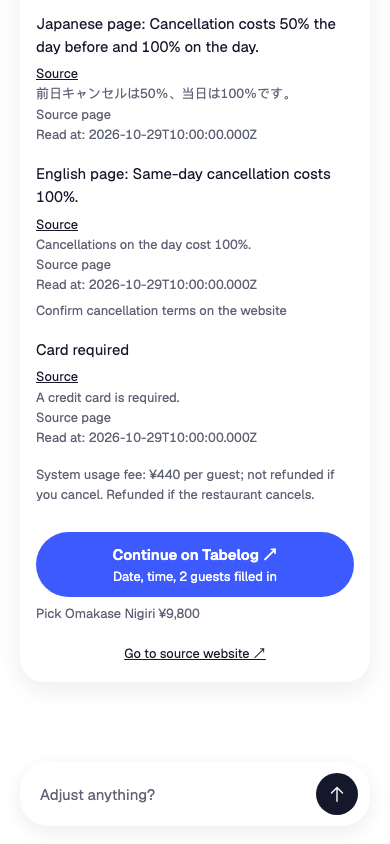
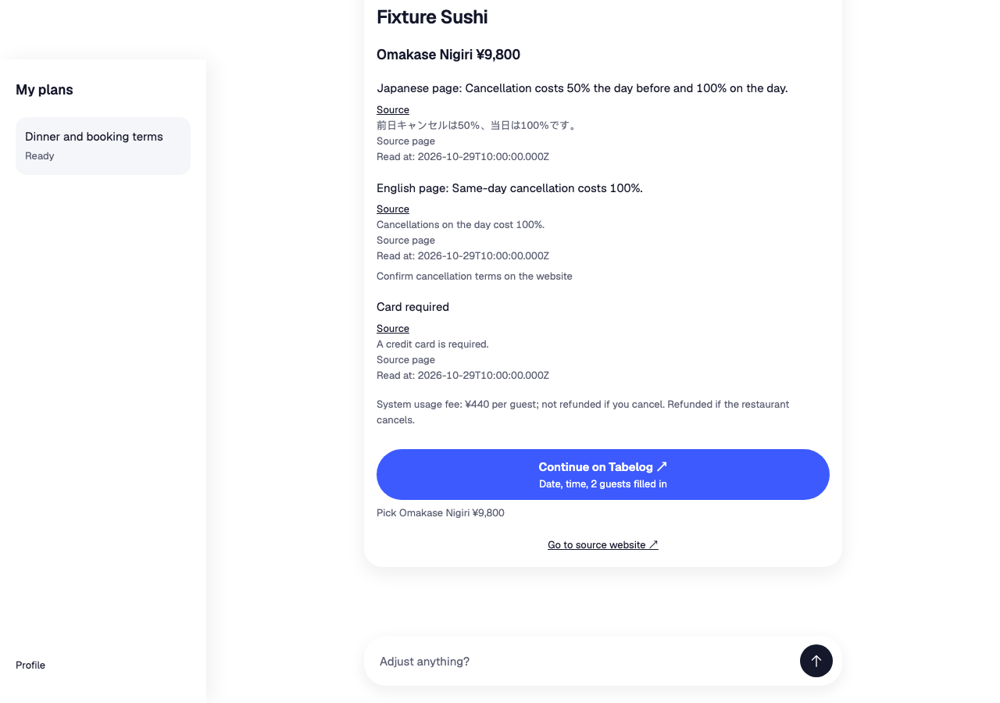

# SR04 离线定位与前端合入复核

- Status: Draft
- Document revision: 0.4
- Last updated: 2026-10-30
- Source of truth for: 用户批准的零API SR04定位、诊断透传修复、main同步与复核证据
- Related documents: [前次停止报告](WEB-WORKSPACE-SLICE1-FOLLOWUP-20261030.md), [切片计划](../WEB-WORKSPACE-SLICE1-PLAN.md)
- Evidence status: frozen regression；离线诊断与完整Fixture验收通过，工作分支待合入复核，非Clean Baseline/Live验收

## 执行前承诺

用户2026-10-30批准：只用保存的10份响应与请求，分别经无守卫和原守卫的克隆读取两次生产Gateway/Interpreter路径；再用现有评分器评价SR04，与Prompt26最近一次SR04目标规则对照。新API、Google、来源GET、Live和Holdout全部0，不加载真实凭据，不补跑模型。输入、原守卫、生产解析及评分路径先提交记录SHA；旧运行/Gold/评分器不改。

控制变量为是否套用原`semantic-transport-guard.mjs`（包含等待`response.clone().text()`）。每次Fake fetch严格核对完整保存请求，只返回原响应字节的新Response，状态200；每轮10次、无重试。实际使用生产Interpreter构造请求、Gateway读取/解析与Interpreter校验；不以独立JSON.parse成功替代生产解析。完整响应回放不重现原网络流、socket和Abort时序。

SR04随后使用相同消息、Gold5、参考时间和既有目标标注，原Compiler/Runtime生成权威Draft，复用现有目标及严格评分器；同样离线重评保存的v26提案并与原评价核对。任一解析失败或目标不一致立即停下；不调整Prompt追分。两项通过后才实施诊断透传、同步用户指定main404a766e，并重跑净树五门禁及390×844/1280×900验收。

修复承诺是失败记录与语义解释器失败结果保留安全的原始错误名/cause code；读取响应体抛异常时，结果可见原因，仍按原失败/结构化表单路径关闭，不记录密钥、Headers、URL或异常消息。复用已有失败测试，先记录未修断言失败，再修复并完整验证。只改必要诊断路径；B1链接/证据、A的Gold/评分器、B的Tabelog/G3、C的Google客户端不手工修改。main合并仅同步已接受上游改动，冲突按文件归属处理。

证据写入独立目录[离线定位包](../../.eval-artifacts/web-workspace-sr04-offline-20261030/)，原真实调用产物不可覆盖。完成后更新STATUS与历史、推送工作分支，不合main，交合入复核。

## 解析与目标核对结果

冻结提交`c1b5999e`，103项输入/脚本/源码SHA，清单SHA256 `ca72439e7020e042ebd5612e49d3f8915786a7c7da03fb7929e0356e1a04afb7`。调用`node --import tsx .eval-artifacts/web-workspace-sr04-offline-20261030/run-offline.mjs`前后核对该清单；运行期间103项未变。该清单描述修复前的定位配置，后续诊断修复和报告更新不改写旧清单。重现此历史定位须使用该冻结提交。

| 控制 | Fake fetch | 完整请求一致 | Gateway/Interpreter正常解析 | SR04 |
| --- | --- | --- | --- | --- |
| 无守卫 | 10 | 10/10 | 10/10 PROPOSED | PROPOSED |
| 原守卫，先等待clone读取 | 10 | 10/10 | 10/10 PROPOSED | PROPOSED |

守卫保存的10份克隆正文与原响应SHA逐一相同。新API请求0，未读取任何真实凭据；不是模型重跑。参见[无守卫原件](../../.eval-artifacts/web-workspace-sr04-offline-20261030/execution/unguarded.json)、[有守卫原件](../../.eval-artifacts/web-workspace-sr04-offline-20261030/execution/guarded.json)及[完成记录](../../.eval-artifacts/web-workspace-sr04-offline-20261030/execution/finished.json)。

SR04原提案经Compiler与内存Runtime得到权威Draft。与v26同一消息、Gold5、参考时刻、B类独立标注下，现有目标评分均为`SATISFIED / AVAILABILITY`；完整提案、TARGET及goalBasis、编译Patch、权威Draft、目标评分和严格评分全部相同。严格评分仍是原有`SEMANTIC_INTERPRETER`不匹配，不把离线目标通过改写为严格回归通过。[现有评分器的成对结果](../../.eval-artifacts/web-workspace-sr04-offline-20261030/execution/score.json)。

因此按用户预定规则，将原SR04新增失败归为**测试守卫或传输层，不计提示词退化**。旧真实运行的`MODEL_FAILURE / NETWORK`、严格0/15及五轮上游阻断原样保留。完整已缓存Response在两条路径都成功，不能区分原时刻的克隆/流/socket/Abort故障；原异常未保留，不能追补具体原因。

## 诊断修复与检错

复用现有Gateway的连接/读正文失败测试，把正文分支接到真实Semantic Interpreter。修复前目标断言实际为`undefined`，独立期望为`TypeError → Error / UND_ERR_SOCKET`，失败关闭与零重试仍成立。[红灯](../../.eval-artifacts/web-workspace-sr04-offline-20261030/diagnostics/red.log)。

Gateway现在保留安全错误名及最多三层cause名称/代码，失败Observer记录与解释器`MODEL_FAILURE.providerError`携带相同诊断；超时也保留原始原因。名称/代码限制为64字符标识符，过滤配置密钥及Secret前缀，不保存异常消息、URL、Headers或socket内容。共用Core诊断类型，移除重复定义；Prompt28/Proposal Schema4和重试规则不变。

原反例及相关Gateway/Interpreter文件17/17通过、typecheck通过；正文分支为原生Response/ReadableStream读取时抛错，并断言结构化表单失败结果、Observer原因相同、实际Fake fetch一次及敏感消息未保存。[绿灯](../../.eval-artifacts/web-workspace-sr04-offline-20261030/diagnostics/green.log)。这只关闭诊断丢失机制，不声称复现或修复了原网络失败。

## main同步与最终验收计划

诊断修复提交`df60d11a`；同步指定main `404a766e300668230d23c75ee7486bb3dc7a1d43`的合并提交`4746b313`。上游只有C已复核PostgreSQL证据和文档，没有可执行变化；5份状态/历史的追加冲突完整保留双方段落，修订号递增，没有手改A/B/C源码、迁移或账本。C原PG结论已随main纳入，本轮不重跑数据库。

最终门禁在另一个提交冻结后的净树执行：typecheck、arch:check、npm test、build、完整test:browser:fixture；每项检查前后净树、HEAD和输入SHA。后者包含完整工作区390×844/1280×900的十项、长条款取消冲突的两入口可见/可点以及原来源/问答三项回归，不以17项局部测试替代实际HTTP/SSE/Runtime/PGlite/Chromium链路。截图另存，不覆盖前两批截图。五门禁不读取.env或调用真实模型/来源/Google，不跑Holdout、Postgres Live或Controlled write。

## 最终验证结果

冻结`474febbaffbe7c2b22a26a698707e40b027b1980`，736项SHA，清单SHA256 `c8ca4f085a7109ccc53b24f51c6b96e61ef20b4220480b69cbaa7f7fcebc6137`。每项门禁前后均净树、HEAD不变、736项输入未变。[完整回执](../../.eval-artifacts/web-workspace-sr04-offline-20261030/gates/gates.json)及同目录原始日志；56份原响应/请求、守卫、v26证据和评分输入逐字节未改，[核对记录](../../.eval-artifacts/web-workspace-sr04-offline-20261030/offline-input-integrity.json)。main带入的PG证据逐字节一致，见[上游完整性](../../.eval-artifacts/web-workspace-sr04-offline-20261030/main-integrity.json)。

| 门禁 | 结果 | 命令耗时 |
| --- | --- | --- |
| npm run typecheck | PASS | 0.580 s |
| npm run arch:check | PASS | 0.280 s |
| npm test | 1211/1211 PASS | 29.210 s |
| npm run build | PASS | 0.537 s |
| npm run test:browser:fixture | 181/181 PASS | 121.601 s |

浏览器门禁保留原G2独占5项、其余176项并发4的调度与原时限，未放宽断言。工作区6项完整脚本（两尺寸各渐进/保存/恢复/当前指代/B1、停止/需求更新、长条款）以及原来源/问答3项共9/9通过；实际使用HTTP、SSE、Application、Interpreter/Compiler、Router、Reducer与PGlite，仅模型/来源传输注入Fixture。

| 验收 | 390×844 | 1280×900 |
| --- | --- | --- |
| 1 备选按安排隔离 | PASS | PASS |
| 2 详情/备选返回原卡片 | PASS | PASS |
| 3 首家就绪自动出现 | PASS | PASS |
| 4 修改需求拒绝旧版迟到结果 | PASS | PASS |
| 5 刷新恢复视图/卡片 | PASS | PASS |
| 6 Choose this不触发提交/授权 | PASS | PASS |
| 7 Stop结束进度且不增加卡片 | PASS | PASS |
| 8 this one指向当前候选且不改变选定 | PASS | PASS |
| 9 出发/提示不出现selected或booked | PASS | PASS |
| 10 SSE保持输入与当前卡片 | PASS | PASS |
| 11 长条款/取消冲突可滚至输入框上方，两个出发入口完整可见且真实点击到本地接收器 | PASS | PASS |

## 四层结论与限制

| 层 | 本轮结论 |
| --- | --- |
| 端到端结果 | 语义保存响应回放20/20正常，SR04离线目标1/1通过；两尺寸完整Fixture链路通过。真实餐厅交付为NOT_EVALUATED，原真实回归结果不回写 |
| 逐环节 | Gateway/Interpreter有守卫10/10、无守卫10/10；SR04 Compiler/Reducer后权威Draft与v26相同，独立B标注目标SATISFIED，严格评分仍是同一历史FAIL；其他9个目标及真实发现/身份/HARD/查位未在本轮重评 |
| 严重程度 | 本轮没有运行真实餐厅交付，不推导S0–S4；正文故障明确失败关闭，无重试或提交。浏览器模拟接收器只证明交接动作，不证明现实预约成功 |
| 归因 | 按用户规则确认归入测试守卫或传输层，不计提示词退化；原克隆与传输流的具体原因仍未确认。诊断丢失有原反例红/修复绿，原外部故障未重现、未宣称修好 |

离线解析/评分共289 ms（started/finished外层时钟），不是模型延迟。计划/实际Fake fetch为20/20、可解析20、目标评价1对1；新增真实模型API/Google/来源GET/Live/外部写入/Holdout全部0，新增真实Token/费用0。先前真实10次/74,043 tokens属于前次报告，不改历史用量。当前查看上下文的真实模型遵循率没有由本轮证明；普通来源G3和实际来源网站带入仍是既有缺口。单店Ask并入主输入框按用户决定留下一段。

## 新截图

本次门禁生成21张原PNG，逐张目视检查并核对尺寸/SHA；[完整清单](assets/web-workspace-sr04-offline-20261030/screenshots.json)。截图为Fixture中的合成店/固定时刻，不能作为来源库存证据。长卡片需滚动查看，操作区截图显示两个入口均在固定输入框上方；前次两批截图原样保留。

| 主要画面 | 390×844 | 1280×900 |
| --- | --- | --- |
| 首页 | [截图](assets/web-workspace-sr04-offline-20261030/mobile-home.png) | [截图](assets/web-workspace-sr04-offline-20261030/desktop-home.png) |
| 查找中 | [截图](assets/web-workspace-sr04-offline-20261030/mobile-searching.png) | [截图](assets/web-workspace-sr04-offline-20261030/desktop-searching.png) |
| 候选 | [截图](assets/web-workspace-sr04-offline-20261030/mobile-candidate.png) | [截图](assets/web-workspace-sr04-offline-20261030/desktop-candidate.png) |
| 详情 | [截图](assets/web-workspace-sr04-offline-20261030/mobile-details.png) | [截图](assets/web-workspace-sr04-offline-20261030/desktop-details.png) |
| 备选 | [截图](assets/web-workspace-sr04-offline-20261030/mobile-saved.png) | [截图](assets/web-workspace-sr04-offline-20261030/desktop-saved.png) |
| 抽屉 | [截图](assets/web-workspace-sr04-offline-20261030/mobile-drawer.png) | 桌面常驻侧栏见各图 |
| B1准备 | [截图](assets/web-workspace-sr04-offline-20261030/mobile-handoff.png) | [截图](assets/web-workspace-sr04-offline-20261030/desktop-handoff.png) |
| 返回自报 | [截图](assets/web-workspace-sr04-offline-20261030/mobile-feedback.png) | [截图](assets/web-workspace-sr04-offline-20261030/desktop-feedback.png) |
| 停止 | [截图](assets/web-workspace-sr04-offline-20261030/mobile-stopped.png) | [截图](assets/web-workspace-sr04-offline-20261030/desktop-stopped.png) |
| 长条款冲突 | [截图](assets/web-workspace-sr04-offline-20261030/mobile-cancellation-conflict.png) | [截图](assets/web-workspace-sr04-offline-20261030/desktop-cancellation-conflict.png) |
| 长条款滚动后两入口 | [截图](assets/web-workspace-sr04-offline-20261030/mobile-cancellation-actions.png) | [截图](assets/web-workspace-sr04-offline-20261030/desktop-cancellation-actions.png) |

诊断与本切片离线承诺完成，交合入复核；只推送`codex/feat-web-workspace-slice1`，本轮不合main。最终代码与736项冻结输入保持不变，门禁后仅增加报告、截图和证据附件。
